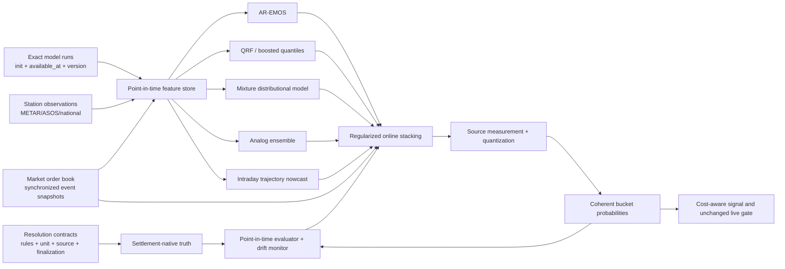

# STRATUS: исследование путей повышения точности

Статус: исследование и целевая архитектура; дополнено релизом truth quarantine 2026-07-21.

Связанные документы:

- [EDGE_VALIDATION_PLAN.md](EDGE_VALIDATION_PLAN.md)
- [QUALITY_ROADMAP.md](QUALITY_ROADMAP.md)
- [STATION_EXPANSION_PLAN.md](STATION_EXPANSION_PLAN.md)
- [FORECAST_REVIEW_2026-07-21.md](FORECAST_REVIEW_2026-07-21.md) — code-level ревью
  прогнозной цепочки (уязвимости F1–F10) и исследовательские нити R1–R8, дополняющие
  эксперименты A–E ниже.

## Дополнение 2026-07-21: epoch 16 truth quarantine

Epoch 16 открыт `2026-07-20T16:27:06.935419Z` по проверенному плану 25
(`05bede4926514ba9248cbba549681c42b8c8e864eb2fad89f103f1edff4814ec`) на точном образе
`sha256:d081e2e640eb5ad713954dbd87d0a3b3d8b1d05b1581017e2e48ff9941531843`.
Поводом стал конкретный дефект truth label: для RKSI HIGH за `2026-07-19` venue разрешил рынок по
`26 °C`, тогда как текущий METAR-derived `daily_actual` равен `27 °C`. Затронуты рынки `2283` и
`2284`; наблюдения сохранены в artifact `68` (48 samples), terminal gap равен 1 800 секундам.

Новый путь подготовки обучающей и диагностической выборки действует fail-closed:

- текущий reconciliation mismatch исключает соответствующий METAR-derived actual;
- canonical exact settlement actual имеет приоритет; одинаковые exact-дубликаты сворачиваются в
  один label, а конфликтующие exact-значения исключают всю station/date/kind ячейку;
- если exact settlement evidence существует, его конфликт или непригодность не разрешает откат к
  METAR;
- resolved/attested market cell без reconciliation также не считается автоматически чистой.

Семантика этой выборки — **current-remediated**, а не исторический as-of replay reconciliation.
Она исправляет то, какие labels допустимы сейчас, но не переписывает sealed prospective
predictions, immutable Gamma ledger или execution evidence. Лицензированное/аттестованное exact
settlement-value coverage по-прежнему равно нулю; релиз не заявляет наличие official exact truth.

После карантина weighted retrospective diagnostic показывает RMSE `1.4255 → 1.3586`, однако
confidence interval независимого settlement-сравнения пересекает ноль. Поэтому результат остаётся
shadow-only, `applied=false`, и не считается доказанным улучшением точности. После проверок
obligations/capacity health остаётся warning-only; RKSI заблокирована для selection и находится в
cooldown.

Контракт проверен полным non-integration прогоном (`860 passed, 3 skipped`), `280` уникальными
PostgreSQL integration tests и отдельным HBA-boundary тестом. Эти проверки доказывают целостность
реализации quarantine/canonical-selection, но сами по себе не доказывают predictive edge и не дают
права включать LIVE.

## 1. Резюме решения

Текущий STRATUS нельзя улучшить одним подбором коэффициентов EMOS. На первой
выборке рынок имел Brier `0.1433`, а модель — `0.1595`; skill P&L был
`-$16.93`, тогда как luck P&L дал `+$119.90`. Это не доказывает, что вся
метеорологическая идея не работает, но показывает, что существующая цепочка не
выделила устойчивый информационный edge.

Главный вывод исследования: следующая версия должна быть
**resolution-native, point-in-time и multi-model**. Она должна прогнозировать
не абстрактную температуру в ближайшей точке сетки, а ровно то дискретное
значение, по которому будет разрешён конкретный рынок, используя только данные,
которые действительно были доступны в момент решения.

Рекомендуемая переработка состоит из пяти частей:

1. Отделить оперативные METAR-наблюдения от settlement truth и сохранять
   версионированный resolution contract каждого события.
2. Создать point-in-time архив отдельных модельных запусков с `init_time`,
   `available_at`, версией модели и фактической задержкой доставки.
3. Для горизонта до 24 часов перейти от прогноза одного daily high/low к
   условному распределению всей оставшейся внутридневной температурной
   траектории с жёстким учётом уже достигнутого максимума/минимума.
4. Запустить несколько независимых challenger-моделей — AR-EMOS, QRF,
   mixture distributional regression и analog ensemble — и смешивать их только
   по out-of-sample skill на независимых station-days.
5. Считать рынок отдельным экспертом с обучаемым весом, а не фиксированной
   shrinkage-константой. Для оценки модели использовать синхронный market
   snapshot, для сделки — исполнимую цену, для CLV — pre-resolution close.

Расширение до 20 станций полезно для скорости накопления данных, но само по себе
не повышает точность. Если объединять неоднородные станции без иерархической
модели, оно может её снизить.

### 1.1. Статус открытых вопросов

| Вопрос | Статус после исследования |
|---|---|
| Exact sources и precision для 20 городов | Ответ получен для активных событий на 2026-07-12; все 20 используют Wunderground, 4 US stations — целые °F, остальные — целые °C. Обязательно перепроверять каждый новый `rules_hash`. |
| Стабильное и допустимое хранение final values | HKO Open Data — да с атрибуцией; Wunderground — только personal non-commercial в рамках публичных условий либо production по лицензии/письменному разрешению TWC. Эквивалентность конкретного TWC API странице settlement ещё требует письменного подтверждения. |
| Market benchmark | Ответ получен: same-horizon snapshot для accuracy, executable bid/ask для решения, pre-resolution close для CLV. |
| Structural breaks 30/60/90/180 | Даты major upgrades известны; фактический размер break STRATUS ещё должен измерить. Сейчас IFS 90/180-day windows смешивают 49r1 и 50r1. |
| Regional models с incremental skill | Покрытие и кандидаты установлены; победители принципиально не могут быть определены без station-level point-in-time bake-off с latency. |

В документе явно разделены подтверждённые внешними источниками факты,
архитектурные выводы и гипотезы, которые должны пройти эксперимент. Численные
улучшения из опубликованных case studies не переносятся на STRATUS без проверки.

## 2. Что именно сейчас ограничивает точность

Аудит текущего кода выявил четыре методологических ограничения:

- `ensemble_component` в `src/stratus/services/probability.py` считает долю
  ensemble-members внутри бакета. Вероятность получается ступенчатой и не
  исправляет underdispersion ансамбля.
- PIT-проверка использует одну Normal(mean, sigma), хотя финальная вероятность
  является смесью моделей, климатологии и рынка. Такой PIT не проверяет
  фактическое итоговое распределение.
- Адаптивные веса строятся из Brier по позициям/бакетам. Бакеты одного
  station-day взаимоисключающие и коррелированные, поэтому nominal `n` выше
  эффективного числа независимых случаев.
- `daily_actuals` строятся из METAR, тогда как resolution truth — значение
  конкретного внешнего источника. Текущая reconciliation находит только случаи,
  когда расхождение меняет выигравший бакет; она не измеряет систематическое
  смещение внутри бакета.

Этот первоначальный пробел закрыт: в probability pipeline добавлен отдельный shadow-challenger
`trajectory_nowcast` (`remaining-day-bias-v1`) с ограничениями
`max_so_far/min_so_far + remaining-day`. Он сохраняет observation-aware прогноз, но не получает
production-вес без собственной будущей выборки и формальной активации; подробности и gate
описаны в разделе «Реализовано 2026-07-12: observation-aware remaining-day nowcast».

## 3. Ответы на открытые вопросы

### 3.1. Exact resolution sources и точность для 20 городов

Снимок активных событий сделан 2026-07-12 через официальный
[Gamma Events API](https://docs.polymarket.com/api-reference/events/list-events)
с `tag_id=84`, `active=true`, `closed=false`. В таблице указаны именно правила
текущих daily temperature markets, а не предполагаемый источник по ICAO.

| Город | ICAO | Текущий resolution source | Публикуемая точность |
|---|---:|---|---:|
| New York City | KLGA | [Wunderground: LaGuardia Airport](https://www.wunderground.com/history/daily/us/ny/new-york-city/KLGA) | целый °F |
| London | EGLC | [Wunderground: London City Airport](https://www.wunderground.com/history/daily/gb/london/EGLC) | целый °C |
| Paris | LFPB | [Wunderground: Paris-Le Bourget](https://www.wunderground.com/history/daily/fr/bonneuil-en-france/LFPB) | целый °C |
| Tokyo | RJTT | [Wunderground: Tokyo Haneda](https://www.wunderground.com/history/daily/jp/tokyo/RJTT) | целый °C |
| Seoul | RKSI | [Wunderground: Incheon Intl](https://www.wunderground.com/history/daily/kr/incheon/RKSI) | целый °C |
| Shanghai | ZSPD | [Wunderground: Shanghai Pudong](https://www.wunderground.com/history/daily/cn/shanghai/ZSPD) | целый °C |
| Miami | KMIA | [Wunderground: Miami Intl](https://www.wunderground.com/history/daily/us/fl/miami/KMIA) | целый °F |
| Amsterdam | EHAM | [Wunderground: Schiphol](https://www.wunderground.com/history/daily/nl/schiphol/EHAM) | целый °C |
| Busan | RKPK | [Wunderground: Gimhae Intl](https://www.wunderground.com/history/daily/kr/busan/RKPK) | целый °C |
| Munich | EDDM | [Wunderground: Munich Airport](https://www.wunderground.com/history/daily/de/munich/EDDM) | целый °C |
| Madrid | LEMD | [Wunderground: Madrid-Barajas](https://www.wunderground.com/history/daily/es/madrid/LEMD) | целый °C |
| Helsinki | EFHK | [Wunderground: Helsinki Vantaa](https://www.wunderground.com/history/daily/fi/vantaa/EFHK) | целый °C |
| Warsaw | EPWA | [Wunderground: Warsaw Chopin](https://www.wunderground.com/history/daily/pl/warsaw/EPWA) | целый °C |
| Singapore | WSSS | [Wunderground: Changi](https://www.wunderground.com/history/daily/sg/singapore/WSSS) | целый °C |
| Taipei | RCSS | [Wunderground: Songshan](https://www.wunderground.com/history/daily/tw/taipei/RCSS) | целый °C |
| Kuala Lumpur | WMKK | [Wunderground: Kuala Lumpur Intl](https://www.wunderground.com/history/daily/my/sepang-district/WMKK) | целый °C |
| Manila | RPLL | [Wunderground: Ninoy Aquino Intl](https://www.wunderground.com/history/daily/ph/manila/RPLL) | целый °C |
| Wellington | NZWN | [Wunderground: Wellington Intl](https://www.wunderground.com/history/daily/nz/wellington/NZWN) | целый °C |
| Chicago | KORD | [Wunderground: O'Hare](https://www.wunderground.com/history/daily/us/il/chicago/KORD) | целый °F |
| Los Angeles | KLAX | [Wunderground: Los Angeles Intl](https://www.wunderground.com/history/daily/us/ca/los-angeles/KLAX) | целый °F |

Общее правило текущей серии:

- берётся highest или lowest temperature, опубликованная для указанной станции
  за локальную календарную дату;
- событие не должно разрешаться до появления первой точки следующей даты;
- учитываются изменения до этого момента, более поздние правки игнорируются;
- источник уже публикует целое значение в указанной единице.

Последний пункт не задаёт математический алгоритм округления сырого сенсорного
значения. Поэтому нельзя применять `round()` и считать это точным воспроизведением
settlement. Система должна моделировать опубликованное дискретное значение и
эмпирически оценить measurement/quantization layer по сохранённым парам
`METAR extreme -> finalized source value`.

Правила нельзя хардкодить по городу. Например,
[London 12 июля 2025](https://polymarket.com/event/highest-temperature-in-london-on-july-12/will-the-highest-temperature-in-london-be-between-84-85f-on-july-12)
разрешался в целых °F, а активный рынок 2026 года — в целых °C. Каждый event
должен создавать неизменяемый contract по `rules_hash`:

```text
event_id, rules_hash, source_family, source_url, station_code,
local_timezone, statistic, source_unit, decimal_places,
finalization_rule, discovered_at, valid_from, valid_to
```

Если parser не может однозначно заполнить любое поле, рынок остаётся `BLOCKED`.

Отдельные города вне текущего пула могут иметь другую truth-систему. Например,
[Hong Kong](https://polymarket.com/event/highest-temperature-in-hong-kong-on-may-2-2026/highest-temperature-in-hong-kong-on-may-2-2026-28c)
разрешался по полю `Absolute Daily Max` в HKO Daily Extract с точностью 0.1°C.
Это подтверждает, что единый глобальный адаптер settlement truth невозможен.

### 3.2. Можно ли стабильно и юридически приемлемо сохранять final values

Краткий ответ:

- **HKO — да**, через официальный Open Data API при соблюдении attribution и
  условий DATA.GOV.HK.
- **Wunderground public page — не как безусловно разрешённый production
  scraper**. Для торговой системы нужен лицензированный TWC API/Data Feed или
  письменное разрешение на конкретный способ получения и хранения.
- **Национальные источники — по отдельному лицензионному реестру**; открытый
  источник не автоматически является settlement source.

[Условия Wunderground](https://www.wunderground.com/company/legal) разрешают
копии данных для personal non-commercial use, ограничивают распространение и
эксплуатацию данных, а commercial use Data Feed требуют обращения к TWC.
Следовательно, автоматический scraping HTML нельзя считать устойчивой
юридической основой будущего live-продукта. Это не юридическое заключение;
окончательное решение должно быть подтверждено владельцем данных или юристом.

The Weather Company предлагает официальный
[Historical Conditions API](https://developer.weather.com/docs/standard-weather-data-package),
но конкретный endpoint нужно письменно сверить с Wunderground History. Например,
описанный TWC daily summary использует сутки 07:00–07:00 local, что может не
совпадать с календарным днём страницы resolution. Совпадение бренда или ICAO не
доказывает идентичность settlement value.

HKO публикует daily maximum/minimum через
[официальный open-data endpoint](https://data.gov.hk/en-data/dataset/hk-hko-rss-daily-temperature-info-hko/resource/1a78c69f-d5ee-4a0d-bb76-1e52aa97ac56).
[DATA.GOV.HK Terms](https://data.gov.hk/en/terms-and-conditions) разрешают
скачивание, воспроизведение и коммерческое/некоммерческое использование при
соблюдении условий и атрибуции.

Рекомендуемая политика хранения:

1. Для каждого source adapter хранить `license_status`, `license_url`,
   `commercial_use`, `retention_allowed`, `attribution_text`,
   `reviewed_at`, `review_expires_at`.
2. До получения TWC-лицензии сохранять из Gamma разрешившийся outcome и
   метаданные рынка. Этого достаточно для Brier по бакетам, но недостаточно для
   обучения непрерывной температуры.
3. Для continuous truth использовать только источник с разрешённым хранением;
   у Wunderground — лицензированный endpoint, у HKO — open API.
4. Сохранять numeric value, unit, source URL, retrieval timestamp, rules hash и
   response hash. Полный raw response/screenshot хранить только если лицензия
   явно это разрешает.
5. Не подменять settlement truth значением METAR/GHCN. NOAA
   [GHCN-Daily](https://www.ncei.noaa.gov/products/land-based-station/global-historical-climatology-network-daily)
   и [LCDv2](https://www.ncei.noaa.gov/products/land-based-station/local-climatological-data)
   являются хорошими независимыми truth/QA источниками, но рынок разрешается не
   по ним.

Почему METAR может расходиться с daily source: ASOS формирует minute-by-minute
данные и отдельные daily summary. Официальный NWS указывает, что DSM содержит
maximum/minimum за 00:00–23:59 local standard time; это другой продукт, чем
почасовой METAR. См. [ASOS Information Reporting](https://www.weather.gov/asos/InformationReporting.html).

### 3.3. Какой market benchmark использовать

Нужны три разных benchmark, потому что они отвечают на разные вопросы.

| Задача | Правильная цена | Почему |
|---|---|---|
| Сравнить predictive accuracy модели и рынка | Последний market snapshot, доступный не позже `forecast_available_at`, на том же horizon | Одинаковый information set и lead time |
| Решить, есть ли исполнимый edge | Side-adjusted executable price в момент решения: ask для покупки, bid для продажи, с fee/depth/slippage | Midpoint нельзя гарантированно исполнить |
| Измерить CLV | Последняя честная цена до resolution information leakage | Показывает качество входа относительно позднего консенсуса |

**Close нельзя использовать как основной Brier benchmark модели**, если модель
была выпущена раньше: close уже знает более свежие прогнозы и наблюдения. Entry
также не универсален — это цена конкретного исполнения, потенциально с
микроструктурным шумом и selection bias. Для model-vs-market нужен именно
одинаковый horizon snapshot.

Для mutually exclusive temperature buckets benchmark должен быть вектором по
всему событию. Mid/bid/ask отдельных токенов могут не суммироваться к единице,
поэтому необходимо:

1. взять синхронный снимок всех бакетов;
2. отбросить stale/zero-depth токены или отметить snapshot непригодным;
3. нормализовать midpoint-вектор к simplex для scoring;
4. отдельно сохранить исходные bid/ask и overround;
5. не использовать resolved price 0/1 как «market forecast».

Prediction-market prices полезны, но не идеально калиброваны. Исследование
[Page & Clemen](https://scholars.duke.edu/publication/765630) показывает
зависимость calibration от времени до expiry и favorite/longshot bias на дальних
горизонтах. [Wolfers & Zitzewitz](https://www.nber.org/papers/w12200) дают
условия, при которых цена близка к средней belief участников, но также отмечают
возможные смещения. Поэтому рынок следует включать как обучаемого эксперта с
признаками horizon, liquidity, spread, depth и time since last trade.

Scoring должен быть prequential и point-in-time:

- Brier и log loss для бакетных вероятностей;
- CRPS для непрерывного distribution forecast;
- calibration slope/intercept и reliability diagram;
- paired score differences с block bootstrap по `station × local_date`;
- отдельные отчёты до/после появления первых наблюдений текущего дня.

Правильность proper scoring rules и разделение calibration/sharpness описаны в
[Gneiting & Raftery](https://academic.oup.com/jrsssb/article/69/2/243/7109375).

### 3.4. Model upgrades и structural breaks в окнах 30/60/90/180 дней

Нельзя назвать один универсальный процент: каждый provider обновляется по
своему календарю, а величина break зависит от станции, горизонта и параметра.
Но риск не теоретический.

ECMWF перечисляет operational cycles:

- IFS 48r1 — 2023-06-27;
- IFS 49r1 — 2024-11-12;
- IFS 50r1 — 2026-05-12.

См. [официальную историю IFS cycles](https://www.ecmwf.int/en/forecasts/documentation-and-support/changes-ecmwf-model).
Последние два интервала составили примерно 16.5 и 18 месяцев: крупный ECMWF
upgrade происходил реже, чем раз в 180 дней, но после каждого upgrade все
trailing windows, пересекающие дату смены, смешивают две генерации модели.

На дату этого отчёта IFS 50r1 работает 61 день. Поэтому:

- 30-дневное окно уже целиком post-upgrade;
- 60-дневное находится практически на границе;
- 90- и 180-дневные окна смешивают 49r1 и 50r1.

Open-Meteo Single Runs прямо фиксирует, что IFS HRES перешёл на 50r1 с
2026-05-12 06 UTC, и хранит exact runs IFS с марта 2024; большинство других
моделей — только с 2026-04-02. См.
[Single Runs API](https://open-meteo.com/en/docs/single-runs-api). Previous Runs
даёт fixed leads 1–7 дней для большинства моделей с января 2024, но это другой
продукт, пригодный прежде всего для screening:
[Previous Runs API](https://open-meteo.com/en/docs/previous-runs-api).

NOAA отдельно показала, что изменения forecast/data-assimilation systems могут
нарушать предположение о постоянном bias в reforecasts:
[Changes in Systematic Errors of Global Reforecasts](https://repository.library.noaa.gov/view/noaa/28095).

Обязательная переработка данных:

```text
model_run_id, provider, model_name, model_version, grid_version,
init_time, upstream_published_at, first_seen_at, available_at,
retrieved_at, forecast_step, valid_time, source_url, checksum
```

Обязательная диагностика:

1. Привязать известные release dates к ряду ошибок.
2. Считать rolling bias, MAE, CRPS и Brier на независимых station-days для
   30/60/90/180 дней.
3. На известных upgrade dates сравнивать paired pre/post residuals; дополнительно
   применять CUSUM/Page-Hinkley к ежедневному score difference.
4. Считать break существенным, если, например, абсолютный station bias изменился
   более чем на 0.25°C/эквивалент °F или CRPS ухудшился более чем на 5% и
   bootstrap CI не включает ноль. Порог является операционным решением и должен
   быть проверен sensitivity-анализом.
5. После break не удалять историю. Держать отдельные параметры по version,
   использовать partial pooling и постепенно переводить вес на новую версию.
6. Если `model_version` неизвестна, источник не допускается к обучению
   calibration без отдельного `unknown_version` режима.

Именно версия, а не произвольная длина окна должна быть первой границей
обучающей выборки.

### 3.5. Какие regional models действительно добавляют skill

Из интернета можно установить покрытие и доступность, но нельзя честно объявить
победителя для конкретной станции без point-in-time backtest. Высокое
пространственное разрешение не гарантирует лучший daily extreme: interpolation,
coastal grid cell, urban heat island и задержка публикации могут убрать выигрыш.

Ниже — shortlist challenger-моделей, а не заранее назначенные веса.

| Станции | Основные challengers | Дополнительные глобальные эксперты |
|---|---|---|
| KLGA, KMIA, KORD, KLAX | NOAA HRRR, NBM v5, LAMP; NAM как контроль | GEFS/HGEFS, AIGFS/AIGEFS, IFS/AIFS |
| EGLC | UKMO UK 2 km, UKMO Global | IFS/AIFS, ICON-EU |
| LFPB | AROME France/HD, ARPEGE Europe | IFS/AIFS, ICON-EU |
| EHAM | KNMI HARMONIE AROME Netherlands/Europe | IFS/AIFS, ICON-EU, UKMO |
| EDDM, EPWA | ICON-D2 где покрывает, ICON-EU | IFS/AIFS, ARPEGE Europe |
| LEMD | ARPEGE Europe; AROME только после проверки domain coverage | IFS/AIFS, ICON-EU |
| EFHK | DMI HARMONIE Europe, MET Nordic при фактическом покрытии | IFS/AIFS, ICON-EU |
| RJTT | JMA MSM, JMA GSM | IFS/AIFS, CMA GRAPES |
| RKSI, RKPK | KMA LDPS/GDPS | IFS/AIFS, JMA GSM |
| ZSPD, RCSS | CMA GRAPES, JMA GSM/MSM при покрытии | IFS/AIFS, AIGFS |
| WSSS, WMKK, RPLL | нет подтверждённого открытого локального high-res лидера; тестировать CMA/JMA/KMA global | IFS/AIFS, ACCESS-G, AIGFS |
| NZWN | BOM ACCESS-G | IFS/AIFS, AIGFS |

[Open-Meteo model catalogue](https://open-meteo.com/en/docs) предоставляет
30+ моделей, включая HRRR/NBM, ICON, AROME, UKMO, KMA, JMA, CMA, KNMI и BOM;
regional updates приходят каждые 1–3 часа, global — обычно каждые 6 часов.
Этот агрегатор удобен для исследования, но production должен сохранять точный
model name/run/version и не использовать `best_match`, который бесшовно меняет
источник.

Для США особенно важны два уже postprocessed продукта:

- [NBM v5](https://vlab.noaa.gov/web/mdl/nbm-documentation), operational с
  2026-05-05, публикует probabilistic maximum/minimum temperature percentiles;
- [LAMP](https://www.weather.gov/media/notification/pdf2/pns22-72_lamp_glmp_v2.5.pdf),
  использует свежие наблюдения и даёт station guidance до 38 часов.

Для глобального пула доступны physics и AI ensembles:

- [ECMWF IFS/AIFS Open Data](https://www.ecmwf.int/en/forecasts/datasets/open-data);
- [AIFS ENS](https://www.ecmwf.int/en/forecasts/datasets/aifs-machine-learning-data)
  operational и имеет архив с июля 2025, но выдаёт 6-часовые steps — этого
  недостаточно для точного daily peak без внутридневного downscaling;
- NOAA operational [AIGFS/AIGEFS/HGEFS](https://www.weather.gov/media/notification/pdf_2025/scn25-89_AIGFS_AIGEFS_and_HGEFS.pdf);
- open-source [GenCast](https://deepmind.google/blog/gencast-predicts-weather-and-the-risks-of-extreme-conditions-with-sota-accuracy/)
  как более дорогой research challenger, а не первый production dependency.

Модель получает ненулевой production weight только если на одинаковых случаях:

- `coverage_before_decision >= 99%`;
- p95 `available_at - init_time` укладывается в SLA данного horizon;
- paired `ΔCRPS < 0` и `ΔBrier < 0` относительно текущей смеси;
- верхняя граница 95% block-bootstrap CI для основной score difference ниже 0;
- выигрыш сохраняется хотя бы в двух последовательных временных folds;
- отсутствует критический calibration regression в tails и у границ бакетов.

Screening можно сделать на Previous Runs с 2024 года. Финальное решение должно
использовать Single Runs/exact init time и реальную latency; для большинства
regional models такой exact archive начинается только 2026-04-02, поэтому их
полноценная история пока короткая.

## 4. Новые архитектуры, не ограниченные текущим EMOS

### 4.1. Resolution-native latent trajectory model

Самая перспективная структурная замена для 0–24h горизонта — моделировать не
daily extreme напрямую, а совместное распределение оставшейся почасовой
траектории температуры.

Для каждого ensemble-member или model forecast создаётся hourly curve. К ней
применяется station-specific residual process с признаками:

- local solar time и solar elevation;
- temperature/dewpoint и trend последних 1/3/6 часов;
- observed max/min so far;
- cloud cover по слоям, shortwave radiation, wind, boundary-layer height;
- precipitation, soil moisture и предыдущая ночная minimum;
- модельный forecast update и расхождение моделей;
- season, weather regime и coastal/urban station embedding.

Затем симулируются коррелированные температурные пути до конца локального дня,
из каждого пути берётся max/min, после чего применяется source-specific
measurement/quantization layer и только затем bucket boundaries.

Преимущества:

- уже достигнутый high/low становится жёстким ограничением;
- вероятность превышения бакета зависит от оставшегося daylight, а не только от
  общего horizon;
- сохраняется многомодальность при разных сценариях облачности/фронта;
- high и low становятся согласованными функциями одной траектории.

Для horizons более 24 часов можно оставить distributional daily-extreme
модель, а в день события переключаться на trajectory nowcast.

### 4.2. AR-EMOS и state-space correction

Это наименее рискованный challenger. Он добавляет авторегрессию последних
station residuals и сезонность к EMOS. В исследовании
[time-series EMOS](https://rmets.onlinelibrary.wiley.com/doi/10.1002/qj.4844)
такие модели часто превосходили стандартный EMOS; авторы использовали rolling
90 дней для AR-параметров и ещё 30 дней для весов.

Для STRATUS AR-часть должна обновляться после каждого нового наблюдения и иметь
разные параметры для day/night transition. Это также естественная основа
Kalman/state-space nowcast.

### 4.3. Quantile Regression Forests / gradient boosted quantiles

QRF не предполагает Normal distribution и может использовать произвольные
предикторы. В исследовании Météo-France
[QRF vs EMOS](https://journals.ametsoc.org/view/journals/mwre/144/6/mwr-d-15-0260.1.xml)
QRF дал более sharp/reliable forecasts температуры и превзошёл EMOS в их case
study; метод впоследствии применялся operational:
[Météo-France postprocessing](https://npg.copernicus.org/articles/27/329/2020/).

Для STRATUS это основной нелинейный challenger после AR-EMOS. Из quantiles
строится monotone CDF, затем bucket probabilities. Требуются walk-forward folds,
иначе лес легко запомнит station/season.

### 4.4. Mixture distributional regression

Одна Normal distribution плохо описывает дни, когда ensemble split между двумя
сценариями — например, фронт проходит до или после дневного максимума.
Mixture regression сохраняет такие режимы. Современный
[MIXSAMOS-GB](https://arxiv.org/abs/2412.09583) существенно превзошёл
state-of-the-art postprocessing в опубликованном German 2m temperature case
study. Это сильный challenger после накопления достаточной точной истории.

Практический порядок сложности:

1. двухкомпонентный Gaussian mixture с регуляризацией;
2. gradient-boosted distributional parameters;
3. normalizing-flow network только если первые два доказали, что
   multimodality действительно важна.

Нейросетевой distributional regression может учитывать station и lead-time
совместно; такие модели превосходили классические benchmarks в отдельных
temperature studies, например
[Neural Networks for Postprocessing](https://journals.ametsoc.org/view/journals/mwre/146/11/mwr-d-18-0187.1.xml).
Но при 20 станциях и коротком exact-run archive сначала предпочтительнее
регуляризованные tree/mixture модели.

### 4.5. Analog Ensemble

Analog Ensemble ищет прошлые модельные состояния, похожие на текущий прогноз,
и использует фактически наблюдавшиеся исходы как empirical distribution.
Основной принцип описан в
[Probabilistic Weather Predictions Based on Analog Forecasts](https://ams.confex.com/ams/92Annual/webprogram/Paper201951.html).

Он особенно полезен как независимый challenger в режимах, где линейный EMOS
ошибается: морской слой KLAX, cloud breakup в London/Amsterdam, фронтальный
тайминг, тропическая конвекция. Analog search должен включать synoptic/regime
features, а не только 2m temperature.

### 4.6. Hierarchical partial pooling и station embeddings

20 станций недостаточно для отдельной сложной нейросети на каждую станцию, но
слишком неоднородны для одной общей calibration. Нужна иерархия:

```text
global effect
  + climate-zone effect
  + source/unit effect
  + station random effect
  + station × horizon effect
  + season/regime effect
```

Новая станция получает разумный prior от похожих станций, но быстро отходит от
него при накоплении собственных данных. Это также правильный способ переживать
model upgrade: новая version получает prior от предыдущей, а не наследует её
bias как истину.

Исследования station-based postprocessing показывают преимущество обучения и
проверки на station observations относительно gridded target:
[Grid vs Station Postprocessing](https://agupubs.onlinelibrary.wiley.com/doi/full/10.1029/2019GL083189).

### 4.7. Online stacking и market-as-expert

Вместо `exp(-k * Brier)` по коррелированным позициям использовать constrained
stacking по out-of-fold predictions:

- неотрицательные веса, сумма 1;
- regularization к равным/предыдущим весам;
- единица обучения — independent station-day-kind;
- decay по времени и отдельные веса по horizon/regime;
- minimum effective sample size;
- fallback weights при отсутствии данных;
- market probability — ещё один expert с признаками liquidity/spread/horizon.

Фиксированное `n/(n+30)` shrinkage должно остаться только conservative fallback.
Основная модель должна научиться, когда рынок сильнее: например, ближе к expiry
и при глубокой книге, и когда собственная погода добавляет информацию: после
нового model run или свежего observation, которое рынок ещё не полностью
отразил.

### 4.8. Conformal calibration как guardrail

Online conformal prediction можно применять поверх любого distribution model
для контроля empirical coverage, особенно на extremes. Свежая работа по
[GenCast, NeuralGCM и AIFS-ENS](https://arxiv.org/abs/2606.19642) показывает,
что даже сильные AI ensembles могут иметь проблемы с coverage на экстремумах и
что online conformal correction способен это исправлять.

Conformal interval не заменяет calibrated bucket probability. Его роль:

- диагностировать undercoverage;
- расширять distribution/tail uncertainty при drift;
- блокировать сделку, если conformal correction резко выросла;
- дать model-risk signal после upgrade.

## 5. Целевая архитектура STRATUS Accuracy v2



Ключевой принцип: все модели обязаны выдавать distribution/CDF непрерывного
latent extreme или траектории. Только один общий resolution layer переводит её
в опубликованную единицу и бакеты. Это исключает расхождение логики между EMOS,
ensemble hits и signal engine.

## 6. Экспериментальная программа

### Experiment A — settlement truth gap

Цель: узнать, сколько денег теряется из-за различия METAR и resolution source.

- Собрать минимум 60 station-days с exact finalized values.
- Считать `source_value - metar_extreme` в source units.
- Разделить по station, high/low, season и пограничности бакета.
- Отдельно измерить долю случаев, когда меняется winning bucket.

Решение: если mismatch меняет бакет хотя бы в 1% случаев или средний bias
значим, continuous calibration переобучается только на settlement-native truth.

### Experiment B — regional model bake-off

Цель: определить models, реально добавляющие incremental skill.

- Screening на Previous Runs 2024+ для fixed 24/48/72h leads.
- Exact-run backtest с 2026-04-02 для regional models и с 2024-03 для IFS.
- Walk-forward: train 60/90/180 дней, validate следующие 14 дней.
- Scores: CRPS, Brier, calibration slope, tail Brier, boundary Brier.
- Block bootstrap по station-day; никакого подсчёта бакетов как независимых.
- Latency simulation использует `available_at`, а не nominal init time.

Результат: таблица `station × horizon × model` со skill, CI, availability и
latency. Без этой таблицы региональная модель остаётся shadow-only.

### Experiment C — architecture bake-off

Сравнить на одном immutable dataset:

1. текущий EMOS;
2. kernel-dressed ensemble EMOS;
3. AR-EMOS;
4. QRF/boosted quantiles;
5. two-component mixture;
6. analog ensemble;
7. regularized stack;
8. stack + market expert.

Primary metric — mean event-level Brier на полном bucket vector. Secondary —
CRPS continuous truth, log loss с clipping, calibration, simulated net edge
после spread/fee. Модель выбирается не по in-sample ROI.

### Experiment D — intraday trajectory nowcast

Сделать replay каждого event day с шагом 30 минут. На каждом шаге модель видит
только уже опубликованные observations и runs. Сравнить:

- daily-extreme forecast без observations;
- bias-corrected forecast с current temperature;
- trajectory model с max/min-so-far;
- LAMP/NBM для США как external postprocessed baseline.

Отдельно оценить 0–3h, 3–6h, 6–12h и 12–24h. Это самый вероятный источник
короткогоризонтного edge, но он должен выдержать book latency и execution costs.

### Experiment E — structural break monitor

Сделать synthetic replay известных upgrade dates, включая IFS 50r1. Проверить,
за сколько station-days monitor обнаруживает bias/CRPS shift и сколько ложных
срабатываний даёт на обычной погодной смене режима.

## 7. Приоритетный roadmap

### Статус реализации на 2026-07-12

Фундамент и все программно разрешимые части плана реализованы:

- migration `0021`: resolution contracts, settlement-native actuals, model/run registry,
  point-in-time evaluations, expert predictions, stack weights, skill reports и drift events;
- discovery fail-closed парсит source, precision, finalization и license policy, а bucket
  boundaries используют квант resolution source вместо фиксированных `±0.5°C`;
- exact settlement truth принимается только аутентифицированно и с provenance/hash;
- live snapshots имеют явную семантику collector snapshot; Single Runs backfill сохраняет
  exact init time и честно маркирует availability как latency proxy;
- ensemble kernel dressing, AR(1)-EMOS, intraday constraints, QRF, analogs, mixture и
  non-negative regularized stacking встроены в probability pipeline;
- глобальный exact-run archive покрывает все 20 станций, а доступные regional/AI collectors
  создают только shadow-кандидатов там, где подтверждены source identity, availability и latency;
  ни один regional model ещё не признан победителем station/horizon/kind bake-off и не получил
  production-вес. Покрытие станции не считается доказательством incremental skill;
- same-horizon market benchmark, executable bid/ask и pre-resolution close разделены;
- 30/60/90/180-day drift audit, health checks, operator API и Cockpit Accuracy Laboratory
  включены в runtime.

Два ограничения остаются внешними, а не программными TODO: лицензия/правомерный способ
долговременного хранения Wunderground и фактически наблюдаемое upstream publication time
для архивных Open-Meteo runs. До их решения система fail-closed: Wunderground actuals не
сохраняются, а архивная latency не выдаётся за измеренную.

### P0 — правильная измерительная система

1. `resolution_contracts` по event/rules hash.
2. `settlement_actuals` с exact value и provenance.
3. Три market benchmarks: horizon, executable, close.
4. Point-in-time model run metadata и запрет look-ahead.
5. Event-level scoring и independent station-day bootstrap.

Без P0 нельзя надёжно выбрать ни EMOS, ни ML-модель.

### P1 — самый дешёвый ожидаемый прирост

1. Kernel dressing и spread calibration ensemble-members.
2. AR-EMOS/state-space residual correction.
3. Max/min-so-far constraints и простой remaining-day nowcast.
4. NBM/LAMP для US stations; AROME/UKMO/JMA/KMA/KNMI challengers в shadow.
5. Version-aware calibration вокруг IFS 50r1 и последующих upgrades.

### P2 — нелинейные challengers и stacking

1. QRF/LightGBM quantile challenger.
2. Analog ensemble.
3. Regularized out-of-fold stacking с market expert.
4. Hierarchical pooling station/climate/source/horizon.

### P3 — структурная смена short-horizon модели

1. Correlated hourly trajectory sampler.
2. Measurement/quantization layer, обученный на exact settlement pairs.
3. Mixture distributional model для split regimes.
4. Online conformal uncertainty guardrail.

### P4 — AI weather sources

1. AIFS ENS и NOAA AIGEFS/HGEFS как operational shadow experts.
2. GenCast только после проверки расходов, latency и локального station skill.
3. Нейросетевой/normalizing-flow postprocessor только после накопления
   достаточного exact-run dataset и победы над QRF/mixture на walk-forward.

## 8. Что не следует делать

- Не увеличивать число сделок ослаблением edge/spread/depth filters ради `n`.
- Не считать 20 городов двадцатью независимыми доказательствами в один
  синоптический день; spatial correlation должна учитываться block bootstrap.
- Не учить модель на latest stitched forecast, если неизвестно, какой run был
  доступен в момент решения.
- Не использовать close как comparator раннего прогноза.
- Не считать математическое `round()` точной копией source reporting.
- Не давать новому regional/AI model вес только из-за более высокого
  пространственного разрешения или глобального headline score.
- Не расслаблять live gate. Переработка модели должна доказать улучшение на
  новом out-of-sample периоде.

## 9. Критерии готовности Accuracy v2

Accuracy v2 считается пригодной для замены текущего probability pipeline, когда:

1. Не менее 95% торгуемых events имеют полностью распарсенный resolution
   contract; остальные fail-closed.
2. Не менее 99% scored forecasts имеют доказуемый `available_at <= decision_at`.
3. Settlement truth coverage не ниже 95% для paper stations.
4. Challenger stack лучше текущей модели по event-level Brier и CRPS; 95%
   block-bootstrap CI score difference не включает ноль.
5. Нет ухудшения tail/boundary calibration более допустимого guardrail.
6. Улучшение сохраняется минимум на двух последовательных walk-forward folds и
   после хотя бы одного model-version boundary либо version-specific replay.
7. Симулированный edge остаётся положительным после реальных bid/ask, fees,
   latency и maker fill model.
8. Существующий live gate остаётся обязательным и пересчитывается только на
   новых, полностью point-in-time paper signals.

## 10. Итог

### Реализовано 2026-07-12: settlement-supervised probability calibration

Поверх базового probability pipeline добавлен `partition-beta-v1`: калибратор обучается на
финальных победителях взаимоисключающих бакетов Polymarket. Это позволяет улучшать вероятности по
официальному исходу рынка даже пока лицензия не разрешает долговременное хранение точного
Wunderground temperature value.

Метод специально не считает бакеты одного события независимыми наблюдениями:

- единица train/test split и bootstrap — `station/day/kind/horizon`;
- OOF-проверка использует детерминированные blocked folds;
- сравниваются event-level Brier и ECE до/после;
- применение разрешено только при `n >= 60`, `CI_high(delta Brier) < 0`, улучшении OOF Brier и
  отсутствии регрессии ECE более чем на `0.01`;
- до выполнения всех условий новые вероятности сохраняются как `settlement_beta` shadow expert,
  а signal engine продолжает использовать прежнюю вероятность;
- параметры, OOF-метрики, CI и статус `SHADOW/APPLIED` доступны в `/api/v1/accuracy-overview` и
  Cockpit Accuracy Laboratory.

Это не заменяет measurement/quantization layer на exact settlement pairs. Калибратор исправляет
наблюдаемую форму распределения вероятностей по bucket outcomes, но без точного published value не
может диагностировать физическую ошибку температуры отдельно от правила округления источника.

### Реализовано 2026-07-12: correlated hourly trajectory challenger

Добавлен prospective challenger `trajectory_ar1` для high/low рынков:

- почасовые deterministic paths хранятся point-in-time в компактной JSONB-строке на
  `station/model/run/local-day`; исходный run и `available_at` не теряются;
- суточный базовый путь строится как robust median доступных ECMWF/GFS/ICON/GEM curves;
- уже прошедшие локальные часы condition-ятся на фактические observations;
- будущая ошибка моделируется 512 AR(1)-траекториями (`rho=0.85`), а вероятности бакетов
  вычисляются из распределения дневного max/min, а не из независимых почасовых ошибок;
- RNG seed зависит только от станции, дня, horizon и model runs, поэтому повторный расчёт
  воспроизводим и не создаёт искусственное minute-to-minute движение вероятности;
- эксперт сохраняется в `accuracy_predictions`, но остаётся `SHADOW`, пока минимум 60
  независимых `station/day/kind/horizon` блоков не дадут `delta Brier < 0` и
  `CI_high(delta Brier) < 0` относительно опубликованной baseline probability того же timestamp;
- после прохождения гейта эксперт становится доступен regularized stack; прямой безусловной
  подмены production probability нет;
- coverage, число блоков, Brier, delta и CI показываются в Cockpit Accuracy Laboratory.

Ограничение первой версии: `rho` пока общий консервативный hyperparameter. После накопления
достаточного архива его можно оценивать иерархически по station/climate/horizon, но только через
blocked OOF replay; in-sample tuning запрещён.

### Реализовано 2026-07-12: online conformal uncertainty guardrail

Для каждого `station/horizon/kind` добавлена отдельная проверка ширины predictive distribution:

- nonconformity score — `abs(actual - corrected_mean) / predicted_sigma`;
- finite-sample quantile использует rank `ceil((n+1) * coverage)` при target coverage 90%;
- scale переводит empirical quantile в Gaussian sigma multiplier и ограничивается диапазоном
  `0.75–2.5`, чтобы единичный выброс не создавал неограниченные tail probabilities;
- minimum residual history — 120, окно соответствует 180-дневному calibration window;
- `conformal_gaussian` сохраняется как point-in-time shadow prediction вместе с scale,
  coverage до/после, sample count и source semantics;
- historical METAR/daily actual может сформировать shadow scale, но не разрешает применение;
- доступ в regularized stack появляется только после минимум 60 будущих независимых
  Polymarket-resolution блоков, отрицательного `delta Brier` и `CI_high < 0` против baseline того
  же timestamp;
- Cockpit показывает sigma multiplier, residual depth, empirical coverage, prospective blocks и
  CI.

Таким образом conformal слой является guardrail против overconfidence, а не способом подогнать
исторический Brier. При отсутствии доказательства на settlement outcomes торговая вероятность не
меняется.

### Реализовано 2026-07-12: observation-aware remaining-day nowcast

Поверх hourly trajectory archive добавлен отдельный challenger `trajectory_nowcast`:

- для текущего local day сопоставляются фактические observations и robust median
  ECMWF/GFS/ICON/GEM path в одинаковых локальных часах;
- требуется минимум три совпавших часа, используется максимум шесть последних;
- hourly residuals проходят median/MAD clipping, затем recency weighting;
- итоговый recent bias ограничен `±4°C`, чтобы ошибочный METAR или единичный model glitch не
  перестроил весь день;
- bias переносится только на ещё не наблюдённые часы и экспоненциально затухает с half-life шесть
  часов; прошедшие observed values остаются неизменными;
- изменение deterministic remaining-day extreme переносится в mean Monte Carlo distribution, после
  чего заново рассчитываются bucket probabilities;
- RNG остаётся детерминированным по station/day/horizon/model-runs/latest-observed-hour;
- `trajectory_nowcast` имеет собственный prospective gate: минимум 60 независимых
  `station/day/kind/horizon` блоков, `delta Brier < 0` и `CI_high < 0` относительно baseline того же
  timestamp;
- до гейта эксперт только сохраняется и отображается в Cockpit; торговая вероятность не меняется.

Это закрывает разрыв между простым правилом «невозможный бакет = 0» и полноценным remaining-day
nowcast: свежий systematic warm/cold miss влияет на ещё возможный дневной экстремум, но не получает
торговый вес без settlement-подтверждения.

Наиболее вероятный путь к точности — не «ещё больше EMOS», а сочетание:

- точной settlement-native цели;
- внутридневного observation-aware nowcast;
- нескольких независимых probabilistic models;
- региональных и AI ensembles как проверяемых экспертов;
- version/latency-aware point-in-time оценки;
- обучаемого сочетания с рынком.

Первая реализационная задача — не сложная нейросеть. Это resolution contracts,
exact truth и point-in-time run archive. После них AR-EMOS, QRF и intraday
trajectory replay дадут честный ответ, нужна ли полная замена модели и какая
архитектура действительно выигрывает на наших 20 станциях.

### Реализовано 2026-07-13: hierarchical partial-pooling EMOS

Текущий live-срез показал, что увеличение выборки само по себе не исправило качество:
на 33 резолвленных сделках Brier опубликованной модели равен 0.2087 против 0.1752 у
рынка, средний CLV равен -0.0142, а skill P&L равен -$77.91. Это малая выборка и не
доказательство постоянного провала, но достаточно сильный сигнал не разрешать локальным
EMOS-параметрам свободно переобучаться на каждом station/model/horizon/kind срезе.

Добавлен prospective expert `hierarchical_emos` версии `partial-pooling-v1`:

- локальная калибровка стягивается к sample-weighted parent pool того же
  `model/horizon/kind` на других станциях;
- целевая станция исключается из parent pool, поэтому её наблюдения не учитываются дважды;
- вес локального fit равен `n_local / (n_local + 60)`; параметр вынесен в конфигурацию;
- требуется минимум три независимые peer-станции; при недостатке peers expert не создаётся;
- частично объединяются bias, slope/intercept и horizon-dependent sigma-параметры;
- основной EMOS и торговая вероятность не меняются: challenger сохраняется отдельно в
  `accuracy_predictions` и имеет статус `SHADOW`;
- для каждого рынка сохраняются local weight, local/peer sample counts, число peer-станций,
  mean/sigma и point-in-time probability;
- prospective gate использует ближайший horizon anchor и независимые
  `station/day/kind/horizon` блоки; применение возможно только после минимум 60 блоков,
  `delta Brier < 0` и `CI_high(delta Brier) < 0` относительно опубликованной вероятности того
  же timestamp;
- после прохождения гейта expert лишь становится доступным regularized stack, а не заменяет
  production probability безусловно;
- API `/api/v1/accuracy-overview` и Cockpit Accuracy Laboratory показывают coverage, локальный
  вес, глубину parent pool, число блоков, delta Brier, CI и статус SHADOW/APPLIED.

Ожидаемый эффект — меньшая дисперсия калибровки на новых и нестабильных станциях. Он пока не
считается доказанным: вывод принимается только по будущим settlement outcomes. Внешний блокер
точности остаётся прежним — без лицензированного exact settlement value система всё ещё не
может отделить физическую ошибку температуры от ошибки округления/источника резолюции.

Live-проверка после деплоя (2026-07-13 08:15 UTC):

- shadow prediction сформирован для 308 рынков;
- типичный срез использует 179 локальных и 3365 peer-наблюдений с 19 других станций;
- локальный вес 0.749; медианное абсолютное отличие от опубликованной вероятности 0.0051,
  среднее 0.0109, максимум 0.1201;
- prospective evidence пока только 1/60 независимых блоков; предварительный delta Brier
  +0.0011, поэтому статус корректно остаётся `SHADOW` и торговая вероятность не изменена;
- расширение до 20 станций выявило лимит asyncpg 32767 параметров. Запись
  `model_skill_reports` и `accuracy_predictions` переведена на batch-upsert по 500 строк;
  восемь последующих минутных `prices-and-signals` циклов завершились успешно.

На том же срезе production-качество остаётся неудовлетворительным: 39 resolved trades,
Brier 0.2143 против 0.1681 у рынка, average CLV -0.0346, skill P&L -$147.26. Поэтому
live gate и автоматическое применение challenger должны оставаться закрытыми.

### Реализовано 2026-07-13: version-aware residual regime challenger

Следующий prospective expert `regime_emos` версии `version-break-v1` закрывает риск того,
что одна калибровка смешивает разные версии численной модели или устойчиво изменившийся
операционный режим:

- residuals строятся отдельно по `station/model/horizon/kind`; несколько прогнозов одного
  дня схлопываются медианой, поэтому частота запусков модели не раздувает effective sample size;
- для известной даты обновления используется version boundary. В текущем каталоге это IFS
  50r1 от 2026-05-12 06:00 UTC; GFS, ICON и GEM пока маркируются
  `operational-unversioned`, поэтому для них используется rolling comparison последних 30 дней
  с предшествующими 90 днями;
- требуются минимум 20 recent и 40 baseline station-days, абсолютный сдвиг не меньше 0.25 °C
  и bootstrap 95% CI, не включающий ноль. Bootstrap детерминирован, 512 повторов;
- correction равна разнице recent median bias и full-window median bias, ограничена диапазоном
  ±2 °C и применяется к mean соответствующего model component. Форма и sigma исходного
  распределения сохраняются;
- known-version и rolling-change события сохраняются в `model_drift_events` вместе с CI,
  глубиной окон, версией, датой границы и источником truth;
- новый прогноз всегда сначала записывается отдельно в `accuracy_predictions`. Он не изменяет
  production probability, пока не накопит минимум 60 будущих независимых
  `station/day/kind/horizon` блоков, не покажет `delta Brier < 0` и
  `CI_high(delta Brier) < 0` против baseline того же timestamp;
- после гейта expert только получает право войти в regularized stack. Он не подменяет baseline
  безусловно;
- `/api/v1/accuracy-overview` и Cockpit показывают число активных/критических сдвигов,
  coverage рынков, самый сильный применимый adjustment, модель/версию/границу, число
  prospective blocks, delta Brier, CI и статус `SHADOW/APPLIED`.

Ограничение интерпретации: rolling detector у неверсионированной модели видит статистический
change point, но не доказывает, что причиной был software upgrade. Это может быть сезонность,
изменение входных наблюдений или pipeline. Именно поэтому исторический сдвиг только создаёт
shadow-кандидата, а разрешение на применение даёт исключительно будущий Brier.

Live-проверка после деплоя (2026-07-13 09:25 UTC):

- обнаружено 132 активных station/model/horizon/kind сдвига, из них 74 critical;
- `regime_emos` сформирован для 143 из 308 текущих рынков;
- для текущих рынков среднее абсолютное отличие от опубликованной вероятности равно 0.015381,
  максимум 0.071717;
- сильнейший adjustment среди текущих рынков — GFS, −1.75 °C, rolling boundary 2026-06-13;
- наиболее крупные исторические shifts включают RPLL/ICON high до −4.1 °C (correction capped
  at −2 °C), KLAX/ICON high до −2.71 °C и EHAM/GFS high 48h+ −2.30 °C. Это диагностические
  факты, не доказательство улучшения;
- prospective blocks ещё отсутствуют (`0/60`), eligible slices `0`, статус `SHADOW`;
  production probability и ставки этим challenger не изменены.

После внедрения текущий торговый срез также не стал считаться лучше задним числом: 39 resolved
trades, Brier 0.214301 против 0.168090 у рынка, average CLV −0.034629, skill P&L −$147.262.
Это корректно: version-aware слой начнёт доказывать или опровергать пользу только на новых
резолюциях. Kill switch и live gate остаются закрытыми.

### Реализовано 2026-07-13: prospective gates для nonlinear distribution models

Существующие QRF, Analog Ensemble и двухкомпонентная residual Gaussian mixture переведены из
неформальных компонентов в три независимо версионированных prospective expert:

- `qrf/qrf-v1` возвращает empirical conditional distribution из листьев dependency-free
  quantile regression forest;
- `analog/analog-distance-v1` ищет ближайшие multi-model + seasonal аналоги и теперь считает
  bucket probability с inverse-distance weights, а не только невзвешенной долей соседей;
- `mixture/residual-mixture-v1` переносит на текущий multi-model mean двухкомпонентное
  распределение исторических residuals;
- training case обязан иметь `fetched_at <= decision_at` и `case_date < target market date`;
  future cases исключаются явно;
- минимум для построения распределения — 60 исторических случаев. Наличие training history
  разрешает только запись shadow prediction, но не его использование;
- каждый expert получает отдельный gate: минимум 60 будущих независимых
  `station/day/kind/horizon` блоков, `delta Brier < 0` и bootstrap `CI_high < 0` против
  опубликованной baseline probability того же timestamp;
- до прохождения gate QRF/Analog/Mixture отсутствуют в `challenger_probabilities` и не могут
  попасть даже в regularized stack. Общий цикл записи больше не может повторно сохранить
  другой challenger под неверной общей версией;
- API и Cockpit показывают для каждого expert coverage рынков, training depth, blocks,
  eligible slices, delta Brier, CI и статус `SHADOW/APPLIED`.

Live-проверка после деплоя (2026-07-13 09:59 UTC):

| Expert | Текущие рынки | Training depth | Mean abs Δ probability | Max abs Δ | Blocks | Applied |
|---|---:|---:|---:|---:|---:|---:|
| QRF | 198 | 169–179 | 0.080028 | 0.480275 | 0/60 | нет |
| Analog | 198 | 169–179 | 0.079018 | 0.581722 | 0/60 | нет |
| Mixture | 198 | 169–179 | 0.052618 | 0.426187 | 0/60 | нет |

Большие максимальные отличия не являются признаком edge — наоборот, они показывают, почему
нелинейные модели нельзя включать по одному in-sample fit. На текущем срезе у всех трёх
`applied=0`, active stack weights также равны нулю, поэтому production probabilities и ставки
не изменились. Первая честная оценка появится после резолюции новых рынков, для которых shadow
predictions были записаны до исхода.

### Реализовано 2026-07-13: prospective gate для regularized stack

Аудит выявил отдельный риск уже после защиты индивидуальных challengers: обученный
`fit_regularized_stack` мог начать влиять на production probability после 30 исторических
бакетов без самостоятельной будущей проверки. Это опасно, потому что 30 бакетов могут
представлять лишь несколько коррелированных station-days, а веса оптимизируются на тех же
исходах.

Новый контракт:

- 30 historical cases разрешают только построить веса и записать shadow prediction
  `regularized_stack/regularized-brier-v1`;
- для каждого prediction сохраняются веса, training depth и market-shrunk fallback probability
  того же timestamp;
- Brier stack сравнивается именно с сохранённым fallback, поэтому после возможного включения
  benchmark не превращается в сам stack;
- единица prospective evidence — независимый `station/day/kind/horizon` блок, а не отдельный
  bucket;
- применение требует минимум 60 будущих блоков, отрицательный mean delta Brier и полностью
  отрицательный bootstrap 95% CI;
- без fit, без свежего eligible report или при 59/60 блоках система fail-closed возвращает
  market-shrunk baseline;
- daily stack weights публикуются как активные только после прохождения gate;
- `/api/v1/accuracy-overview` и Cockpit показывают current markets, training depth, blocks,
  eligible slices, delta Brier, CI и статус `SHADOW/APPLIED`.

На момент внедрения активных stack-весов нет. Это ожидаемо: у nonlinear experts 0/60 блоков,
а новые stack predictions ещё только начнут накапливать независимые резолюции. Изменение не
улучшает исторический Brier задним числом; оно предотвращает недоказанное ухудшение в будущем.

### Реализовано 2026-07-13: leave-one-station-out hierarchical stack

Проверка cold-start показала, что у каждого существующего локального
`station/horizon/kind`-среза было только 11 resolved bucket cases, поэтому порог 30 не позволял
даже начать prospective оценку stack. При этом по общим `horizon/kind`-срезам уже накоплено
достаточно данных от нескольких станций.

Добавлен безопасный parent-pool режим:

- если локальных cases не меньше 30, fit остаётся локальным;
- иначе используются только другие станции с тем же horizon и kind;
- целевая станция полностью исключена из training pool;
- parent fit требует минимум 30 bucket cases и минимум три peer stations;
- в prediction сохраняются `fit_source`, `local_sample_n`, `peer_sample_n`, число peer stations
  и веса экспертов;
- parent fit даёт только shadow probability: для применения всё равно нужны 60 будущих
  независимых блоков именно целевого station/horizon/kind-среза, отрицательный delta Brier и
  отрицательный `CI_high`;
- при отсутствии peer depth, fit или prospective report система возвращает market-shrunk
  baseline.

Live-срез после деплоя (2026-07-13 12:27 UTC):

- 154 текущих рынка получили `regularized_stack` shadow prediction;
- training depth 33-44 cases из 3-4 peer stations;
- mean absolute difference от baseline 0.0450, maximum 0.6637;
- eligible 0, active stack weights 0, production probability не заменена;
- Cockpit показывает `peer_pool`, local/peer depth, stations, blocks, delta Brier и CI.

Большой maximum delta — дополнительная причина сохранять fail-closed режим. Это не
доказательство точности; первый честный вывод появится только после будущих резолюций, для
которых эти 154 predictions были сохранены заранее.

Параллельная проверка resolution mismatch дала 45/45 попаданий METAR-derived daily extreme в
фактически победивший bucket. На доступной четырёхдневной выборке источник резолюции пока не
объясняет отрицательный Brier; основной текущий кандидат — качество model combination. Exact
source values всё равно остаются незакрытым требованием для анализа ошибок внутри bucket.

### Implemented 2026-07-13: probability pipeline cohort validation

Historical evaluation previously mixed orders produced by materially different probability
architectures. That was useful for an all-time research report but unsafe for live promotion:
a new model could theoretically inherit the Brier record of an older model.

The deployed contract is now:

1. Every probability snapshot stores `components.pipeline.version`.
2. Every resolved order is attributed to the latest probability snapshot available at signal
   time, including that pipeline version.
3. Brier root-cause diagnostics include `pipeline_version` as a first-class slice and support
   drill-down to the underlying orders.
4. Overall Brier remains available as an all-history diagnostic; Cockpit additionally shows
   current-version Brier and current-version resolved sample size.
5. The formal live gate scores station calibration and model-vs-market Brier only on the
   current version and requires at least 100 resolved trades in that cohort.
6. Missing or malformed version metadata fails closed. Legacy rows are labelled `unknown` and
   cannot validate the current architecture.
7. The effective cohort appends a deterministic 16-hex fingerprint of the material forecast,
   probability, calibration, challenger and stacking source plus all probability-relevant
   settings. A code/config change therefore creates a new cohort even when the semantic version
   was not manually changed.

Initial cohort: `stratus-accuracy-v4-20260713`. Its resolved sample starts at zero by design;
the pre-existing resolved trades remain useful for historical CLV/skill diagnosis but do not
constitute prospective evidence for v4.

Production verification at 2026-07-13 15:19 UTC found 308/308 latest model-probability rows
with cohort `stratus-accuracy-v4-20260713+288a6515612324d1`.
`/api/v1/edge-report` returned 39 historical resolved trades, 0 v4 resolved
trades, no current-version Brier yet, and a blocked live gate. This is the intended cold-start
state: v4 can trade only in paper mode and must earn its own prospective record.

### Implemented 2026-07-13: prospective trade-selection challengers

The first 50 legacy executed orders exposed a selection-bias pattern: model-minus-market Brier
was +0.076 and predicted-edge slope versus realised return was -1.68, even though the broader
point-in-time forecast-evaluation set had better Brier than the market. Large apparent edge was
therefore associated with worse realised outcomes.

It would be invalid to block v4 slices using that legacy sample. Instead, three monotone
edge-cap policies (10c, 15c, 20c) are scored as frozen shadow challengers only on the effective
v4 cohort. They are compared with baseline using information value
`market_squared_error - model_squared_error`; rejected trades contribute zero. Confidence is
bootstrapped by independent `station/day/kind` blocks. Minimum evidence is 100 opportunities,
60 blocks, 30 retained trades and 35% retention, followed by model Brier below market and a
strictly positive CI lower bound for improvement. There is no automatic activation path.

Live verification at 2026-07-13 15:43 UTC confirmed the intended cold start. The effective
cohort remains `stratus-accuracy-v4-20260713+288a6515612324d1`, with zero resolved
current-cohort opportunities. All three edge caps are therefore `Collecting`, not qualified.
The 51 legacy opportunities are displayed only as context (edge slope -1.7177;
model-minus-market Brier +0.075803) and cannot determine a v4 policy decision.

### Implemented 2026-07-13: immutable pre-outcome policy evidence

Purely retrospective thresholding is vulnerable to accidental hindsight: even a fixed-looking
report can be reinterpreted by later code. Selection-policy membership is now durably recorded
for each filled, unresolved order. The ledger stores the policy-definition hash and probability
cohort and is append-only under a unique `(order_id, policy_name)` constraint. Analytics accepts
only rows recorded before resolution with the current definition hash and the same cohort as the
trade. This turns the edge-cap comparison into a prospective experiment rather than a mutable
post-hoc slice.

At the first production capture, 14 unresolved orders received all four decisions (baseline and
three caps). One order belongs to the current v4 cohort; it is recorded but unresolved. Thus the
experiment is operational, while its evidence count remains honestly 0 resolved and no policy
can qualify.

### Implemented 2026-07-13: interval-censored settlement-source correction

The absence of legally storable exact source values does not imply that the resolution carries
no temperature information. A winning bucket gives a censored interval. A new shadow Gaussian
challenger therefore estimates source bias and dispersion by maximizing the probability mass of
the complete winning interval, including open tails. It explicitly avoids the common but invalid
shortcut of treating the bucket midpoint as the observed temperature.

Validation has two layers:

1. deterministic blocked five-fold OOF on historical independent winning-bucket events;
2. a separate 60-block prospective delta-Brier gate against the timestamp-matched production
   probability stored with every shadow prediction.

The first real fit used 57 complete blocks. It estimated only a small warm offset (`+0.098°C`)
and modest narrowing (`sigma × 0.913`), but worsened OOF Brier from `0.06131` to `0.07113` with a
fully positive degradation CI `[+0.00389, +0.01589]`. It is therefore not an accuracy upgrade and
remains unapplied. This falsifies the simple global source-bias hypothesis on current evidence;
future work should prefer station/source hierarchical effects only after substantially deeper
per-source data, rather than forcing this global correction into production.

### Implemented 2026-07-13: pre-outcome tests for weak trade slices

The legacy trade sample shows the strongest joint model/execution failure in `buy_yes` and
`6-24h`: both have positive model-minus-market Brier deltas (`+0.1304` and `+0.1064`) and
negative mean CLV (`-0.0488` and `-0.0510`). Applying those filters immediately would be a
post-hoc rule learned from a different pipeline cohort. Instead, the hypotheses are now frozen
as `exclude-buy-yes-v1` and `exclude-horizon-6-24h-v1` in the immutable pre-resolution policy
ledger. Future v4 outcomes will score the filters against baseline on exactly the opportunities
whose decisions were stored before resolution. The 100-opportunity/60-block/CI gate and the
absence of automatic activation are unchanged.

The alternative idea of splitting the interval-censored source correction by high versus low
was evaluated before adding code to runtime. The high subset (`n=40`) degraded blocked-OOF
Brier from `0.06895` to `0.07643`; the low subset (`n=17`) was too shallow to fit. It was not
implemented. This narrows the next source-correction hypothesis to genuinely hierarchical
station/source effects after more per-source resolution depth, not more global segmentation.

### Implemented 2026-07-13: locally calibrated convex model weights

The historical archive is deep enough to test model weighting without waiting for the newly
added regional collectors: all 20 stations have roughly 900-1,075 usable dates per global model
and the calibration table has about 139-180 observations per station/kind/horizon scope. A
pre-outcome temperature challenger now learns from ECMWF, GFS, ICON, and GEM while leaving the
production probability pipeline untouched.

The experiment intentionally separates calibration from weighting. An affine correction removes
each model's local bias and scale error; projected-gradient optimization then fits a convex
combination with L2 shrinkage toward the declared operational prior. Convexity prevents unstable
negative model weights, the slope is bounded to `[0.25, 1.75]`, and residual sigma has a `0.5 C`
floor. When a target horizon lacks enough history, only the nearest horizon at the same station
and high/low kind may supply a fit; cross-station pooling is not silently introduced.

Leakage controls are part of the evidence, not an afterthought:

- rolling folds train strictly before their validation interval;
- model upgrades are naturally exposed to the next fold instead of being randomly mixed across
  train and validation;
- uncertainty is resampled by station/date/kind event rather than by correlated bucket rows;
- live shadow rows require every input forecast to have been available by the exact baseline
  prediction timestamp;
- event-bucket probabilities are normalized before storage and retain the matched baseline
  probability and complete fit provenance.

The production walk-forward result is materially positive for the METAR target: 20,604
predictions across 7,088 independent event blocks, RMSE `1.425470737 -> 1.358599116 C`, and
delta MSE `-0.1861753 C^2` with 95% CI `[-0.2068396, -0.1555320]`. Forty-eight current local
scopes produced 528 shadow market probabilities. A single example scope assigned approximately
ECMWF 38.0%, GFS 31.2%, ICON 22.9%, and GEM 8.0%; operational telemetry therefore reports
weights averaged over unique scopes rather than presenting this example as a global optimum.
The first production telemetry average over 48 scopes was ECMWF 34.5%, GFS 32.5%, ICON 19.6%,
and GEM 13.4%, with 195-364 local training cases per scope.

The remaining uncertainty is the target mismatch identified by the resolution-source research:
historical training predicts `daily_actual_metar_extreme`, while money settles against the
market-specific published source and rounding rule. The historical result therefore satisfies
only the prior-evidence layer. The challenger remains `SHADOW`, `applied=false`, and must collect
60 future `station/day/kind/horizon` resolution blocks. It can be considered for a manual design
review only if its timestamp-matched delta-Brier upper confidence bound is below zero. Regional
models remain the next independent challenger after they have sufficient point-in-time archive
depth; they are not mixed into this result retroactively.

#### Settlement-aligned transfer test

The METAR result was followed by a separate test against the actual Polymarket winning buckets.
For each resolved event/horizon, the backtest selects only global forecasts whose
`available_at` is no later than the stored production decision timestamp. It refits local affine
corrections and convex weights using the 365 days strictly preceding the market date. Multiple
horizons for one station/date/kind share a bootstrap block, preventing one realised temperature
from being counted as several independent outcomes.

Coverage was sufficient for diagnosis: 63 fitted horizon-events, 45 independent weather blocks
and 693 market-bucket rows. The weighted distribution scored Brier `0.061449` versus `0.058577`
for the timestamp-matched production probabilities, a delta of `+0.002872`. The block-bootstrap
95% interval `[-0.007015, +0.008590]` crosses zero. Therefore the historical settlement test is
`NOT PROVEN`: it neither establishes improvement nor statistically significant degradation.

This divergence is scientifically useful. Better prediction of the stored METAR extreme does
not automatically imply better probability for the market's licensed source, rounding rule and
bucket boundaries. The UI and API now expose RMSE evidence and settlement-Brier evidence as
separate claims. The settlement backtest is a retrospective prior only; the immutable 60-block
future Brier gate remains mandatory and is still at zero.

#### Rounding audit and empirical shrinkage challenger

Before changing the settlement distribution, the active rules were audited directly. Of 101
active contracts, 83 resolve from Wunderground values reported in whole degrees Celsius and 18
from whole degrees Fahrenheit. Every inspected contract uses the `next_day_first_point` event
rule. The parser already represents a published integer as a latent interval extending half a
source unit on either side; Fahrenheit half-units are converted to Celsius before probability
integration. Consequently, the existing market buckets are geometrically consistent with the
published rounding rules, and no production boundary correction is warranted.

The non-Gaussian hypothesis was tested with a robust residual kernel whose bandwidth is estimated
from the strictly prior local residuals and floored at `0.15 C`. The empirical distribution alone
scored Brier `0.0608518`, compared with `0.0585773` for the timestamp-matched production
probabilities. Paired block-bootstrap delta was inconclusive, with 95% CI
`[-0.0076754, +0.0086688]`. This rejects an immediate empirical-only replacement.

The follow-up challenger uses a fixed 25% empirical contribution and retains 75% of the production
probability. The weight is a conservative design constant, not an outcome-optimized parameter.
Its historical settlement Brier was `0.0566114`; paired delta versus production was `-0.0019659`,
with 95% CI `[-0.0045364, -0.0005017]`. The complete interval is below zero, so the challenger
passes the retrospective settlement-aligned evidence layer.

This pass must not be interpreted as a live or production gate. The broader experiment family was
already visible when the fixed shrink design was chosen, and the 45 historical station/date/kind
blocks are not future evidence. The candidate is therefore stored separately as
`historical_weighted_shrunk/convex-affine-empirical-shrink25-v1`, remains `applied=false`, and
starts a new immutable prospective comparison at `0/60` blocks. Current shadow rows preserve both
the weather-training truth source and `prospective_polymarket_resolution` as the promotion truth
source. The production cohort and its probability fingerprint are unchanged.

### Implemented 2026-07-14: sealed-v2 prospective evidence protocol

The v1 weighted/shrunk cohort exposed an evidence-design weakness before any of its predictions
resolved: `accuracy_predictions` could be upserted under the same logical key. Complete details in
a JSON payload were useful for debugging, but mutable details are not confirmatory evidence.
Consequently every v1 row is now legacy diagnostic evidence only and is marked
`evidence_eligible=false`. No v1 resolution may be promoted, copied, or backfilled into the v2
sample.

The clean cohort uses `convex-affine-temperature-sealed-v2` and
`convex-affine-empirical-shrink25-sealed-v2`. Each prediction is frozen before its outcome with:

- a foreign-key link to the exact timestamp-matched production `model_probs` row;
- `generated_at` and the input/training cutoff used at publication;
- a SHA-256 `input_hash` over the baseline probability, market geometry, selected point-in-time
  forecast rows, fit parameters, and training-data hash;
- an `experiment_fingerprint` that binds the expert version and experiment definition;
- a deterministic `record_hash` over the complete immutable evidence content.

The database ledger rejects row updates and deletes. Identical retries are safe insert no-ops;
different content under an existing evidence key raises an integrity error. Formal accuracy
reports query only sealed, hash-complete rows linked to the exact baseline. They additionally
require `prediction_ts <= generated_at`, `training_cutoff <= generated_at`, and
`generated_at < resolves_at`. Training cases satisfy `valid_date < training_cutoff`, so neither
the target day nor a later observation can enter the fit. Missing provenance reduces coverage;
it is never reconstructed after resolution.

This reset is deliberate: the statistically positive historical shrink result remains prior
evidence, while confirmatory settlement evidence for sealed-v2 begins again at `0/60` independent
future blocks. The production pipeline is unchanged and `applied=false`.

Regional-model evidence is subject to the same point-in-time standard. A station/model/horizon
slice fails closed unless every contributing forecast run has both an upstream-verified
availability timestamp and explicit `upstream_run` init-time semantics. Retrieval-time or locally
inferred timestamps may be displayed for archive diagnostics but cannot establish availability,
enter an eligible bake-off, or justify a regional production weight. Regional challengers remain
shadow-only until that source-level verification exists and their own prospective sample passes
the pre-registered gate.

The deployed implementation additionally server-attests publication time with PostgreSQL
`clock_timestamp()`, validates the stored baseline scalar and pipeline version against the exact
foreign-key row, recomputes record hashes during audit, and scores only complete event vectors.
Its denominator comes from independent forecast-evaluation coverage, so missing events or buckets
cannot improve the apparent sample. On deployment the clean cohort started with 308 markets per
expert (616 sealed rows), one fingerprint per expert, zero integrity failures, and `0/60` resolved
blocks. This is the prospective baseline for all later claims; the prior v1 sample remains
diagnostic only.

### Реализовано 2026-07-14: sealed-v2 для всех probability challengers

Протокол подтверждающих данных обобщён из weighted-эксперимента в общий модуль
`sealed_accuracy`. Теперь challenger-распределения, создаваемые `recompute_probs`, и отдельный
interval-censored challenger переводятся в новые версии `*-sealed-v2` до записи формального
prospective evidence. Старые версии остаются диагностическими, имеют
`evidence_eligible=false`, не наследуют новый fingerprint и не могут заполнить новый гейт задним
числом. Для каждого expert/fingerprint подтверждающая выборка начинается заново с `0/60`
независимых resolution-блоков.

Sealer работает на полном векторе взаимоисключающих бакетов события и закрывается при любой
неоднозначности. Все бакеты должны иметь одинаковые event, timestamp и effective pipeline
cohort, полный набор активных market IDs и точную строку production `model_probs` того же market
и timestamp. Candidate-вектор и baseline-вектор нормализуются отдельно и после
детерминированного квантования обязаны суммироваться ровно в единицу. Исходный baseline не
подменяется нормализованным: в evidence сохраняются его точные raw probability и
`model_prob_id`, а нормализованная величина помечается отдельно. Общий input hash связывает
геометрию рынка, исходный challenger payload, raw baselines, нормализованный event cohort и
fingerprint probability pipeline.

Interval-censored job и общий recompute path передают sealer полный persisted market universe
события, включая blocked или unverified sibling buckets, а не только рынки, для которых удалось
построить candidate. Поэтому пропущенный бакет уменьшает coverage и закрывает весь cohort, но не
превращает неполный результат в искусственно полный event vector.

Formal audit не доверяет нормализованному baseline из JSON. Он повторно загружает неизменяемые
`ModelProb` по сохранённым foreign keys, заново нормализует и детерминированно квантует полный
baseline vector, а JSON использует только как значение для проверки совпадения. Любое расхождение
исключает cohort. Для weighted challenger действует дополнительный fail-closed guard: сумма raw
production baseline до нормализации должна находиться в пределах `1 ± 1%`; значение вне
`[0.99, 1.01]` рассматривается как пропущенный, дублированный или несогласованный бакет и не
маскируется нормализацией.

Формальная identity evidence теперь равна `model_probs.components.pipeline.cohort`. Это
семантическая версия pipeline вместе с fingerprint материального кода и конфигурации.
`pipeline.version` используется только как compatibility fallback для старых baseline-строк, у
которых поле `cohort` отсутствует. Группировка событий, input hash, experiment fingerprint,
baseline metadata и audit используют одну и ту же effective identity, поэтому изменившаяся
сборка не наследует evidence предыдущего fingerprint под тем же текстовым номером версии.

Material pipeline fingerprint включает исходный код общего sealer, interval-censored entry point
и weighted entry point: `services/sealed_accuracy.py`,
`jobs/generate_censored_challenger.py` и `jobs/generate_weighted_ensemble.py`. Изменение правил
нормализации, выбора event universe или построения weighted evidence автоматически создаёт новый
effective cohort, даже если разработчик не изменил semantic version вручную.

Migration `20260714_0028` защищает вторую сторону paired comparison. Если строка `model_probs`
уже указана как baseline в eligible sealed evidence, PostgreSQL запрещает её удаление и любое
материальное обновление. В результате после публикации нельзя переписать ни challenger, ни его
точку сравнения.

Migration `20260714_0029` переносит проверку effective cohort в PostgreSQL. При вставке eligible
evidence база самостоятельно получает `pipeline.cohort` из точной baseline-строки, при его
отсутствии использует `pipeline.version` и отклоняет несовпадающий
`baseline_pipeline_version`, переданный приложением. Cohort attestation больше не зависит только
от Python-кода.

Сбор shadow-вероятностей сделан явным этапом расписания. Полные shadow probability cohorts
назначены на 00:18, 05:18, 06:18, 12:18 и 18:18 UTC. Снимок 05:18 дополнительно создаёт свежий
baseline перед interval-censored job в 05:20 и weighted ensemble в 05:22. Обычные минутные
forecast, ensemble и price cycles продолжают обновлять production probabilities и сигналы, но
записывают `evidence_eligible=0`; подтверждающую выборку создают только явно назначенные shadow
snapshots. Все новые варианты остаются `SHADOW`, не имеют auto-apply, не меняют production
pipeline и не ослабляют режим PAPER либо существующий live gate.

После закрытия полноты candidate и реконструкции baseline следующие P0-задачи переходят к двум
оставшимся изменяемым или синтетическим сторонам оценки:

1. immutable Gamma outcome event ledger: сохранить полную mutually-exclusive resolution vector,
   raw response hash, server-attested first-seen time, event/rules identity и запретить
   последующую правку outcome; accuracy audit должен реконструировать winner vector из этого
   ledger, а не из изменяемых строк `markets`;
2. dual-token benchmark: независимо архивировать исполнимые YES- и NO-книги и считать benchmark
   по реальной стороне сделки, а не выводить вторую цену как `1 - p`. Это отделит probabilistic
   skill от ложного edge, возникающего из асимметрии спреда, глубины и ликвидности токенов. Для
   каждой стороны сохраняются token identity, timestamp, bid/ask, depth и hash исходного snapshot.

До появления этих двух point-in-time immutable ledgers не следует добавлять в confirmatory
program новую model family или новый promotion rule.

### P0 queue update 2026-07-14

The immutable Gamma outcome ledger described above is now production-attested under migration
`20260714_0030`. The remaining P0 is the dual-token executable-book benchmark: both YES and NO
books must be captured independently and sealed before confirmatory market comparisons can be
trusted. This status update supersedes the preceding pre-deployment queue. No new model family or
promotion rule should enter the confirmatory program before that benchmark is complete.

### Production verification 2026-07-14

Migration `20260714_0029` применена при остановленном worker после создания и проверки dump
`backups/stratus_pre_0029_20260714T061615Z.dump` размером 215 985 692 байта. Финальный
all-station cycle обработал 837 активных рынков. Challenger stages записали 7 964 eligible rows
по 825 рынкам и 13 diagnostic/shadow experts. Внутри снимка каждый expert имеет один fingerprint,
число несовпадений effective cohort с FK-linked `ModelProb` равно нулю, `applied=true` отсутствует.
Минутные циклы несколько раз подтверждены с `sealed_predictions=0`; evidence публикуется только
явным shadow cycle. После него interval-censored job записал 825, weighted job — 1 650 prediction.

После финального restart production ledger содержал 43 923 eligible rows; все 43 923 record hashes
прошли повторную проверку. `/healthz`, `/readyz` и `/api/v1/accuracy-overview` вернули HTTP 200,
PostgreSQL, API, worker и backup работали, runtime остался `paper`, kill switch выключен. До
deployment прошли 311 unit tests, 87 integration tests с настоящим PostgreSQL, полный Ruff и
strict mypy. Это подтверждает целостность evidence и работоспособность системы, но не доказывает
predictive skill: новый effective cohort должен накопить будущие независимые resolution blocks,
прежде чем возможна promotion decision.

### Outcome truth protocol: immutable Gamma event ledger (P0 acceptance design)

Status: **implemented, migrated under `20260714_0030`, backfilled and production-verified**.

The resolution target has the same evidence problem as a forecast if it can be rewritten after
the comparison is known. `markets.resolved_outcome` is useful for positions and UI state, but it
is a mutable projection and therefore cannot be the authoritative target for confirmatory Brier
claims. The formal target will be a separately sealed Gamma event observation.

The observation unit is the complete mutually-exclusive event, not an independently parsed
market. STRATUS preserves the exact decoded HTTP entity body produced by `httpx` after content
decoding and before JSON parsing, plus its byte length and SHA-256 digest. PostgreSQL independently
checks the stored `BYTEA` against both. It also supplies the first-seen timestamp and binds the
event/source IDs, full market universe, bucket geometry and rules identity into one deterministic
record hash. A valid vector contains every persisted bucket once, contains no unrecognised bucket,
consists only of final binary prices, and has exactly one YES winner. Outcome labels are interpreted
by their explicit labels rather than by assuming a fixed array order.

This design makes retry semantics part of the evidence protocol: the same canonical vector may be
replayed safely, including a later Gamma response whose unrelated metadata changed, but it cannot
replace the retained first raw witness. A changed canonical vector for an already sealed event is
an integrity event that requires investigation. It must not overwrite the first observation.
Database triggers reject update/delete operations, malformed source bytes/hashes and direct
inserts that violate completeness or the exact persisted-market projection. A deferred constraint
trigger requires every market projection to be linked, resolved and consistent by transaction
commit, so an orphan ledger cannot be persisted. Formal consumers reparse the retained body and
independently recompute the vector, market-universe, rules-manifest and record hashes before
accepting a row. The settlement job seals the event before copying the result into the operational
market rows in the same transaction.

All formal forecast evaluation and challenger audits reconstruct their one-hot winner vector from
this ledger. Event-level learners additionally require the exact duplicate-free bucket set at one
decision timestamp; partial vectors are excluded even if their probability sum looks plausible.
The operational market outcome may be cross-checked and alerted on, but cannot substitute for
missing sealed evidence. Consequently, missing or invalid event observations lower coverage rather
than being repaired from mutable state. Gamma market close time is retained for CLV, while actual
settlement time drives realised-P&L accounting and loss limits. This closes the outcome-side
evidence gap; it does not by itself demonstrate predictive skill or permit challenger promotion.

Acceptance evidence includes parser tests for reversed labels, missing/duplicate labels, zero/two
winners, malformed times and terminal prices, plus real-PostgreSQL tests for exact raw hashes,
server time, identical replay, conflicting replay, append-only enforcement and invalid event
projections. Production migration and post-deployment verification are recorded below.

Focused local verification passed 29 strict Gamma parser/witness unit tests and 14 immutable-ledger
PostgreSQL tests. The complete local acceptance run passed 340 unit and 105 real-PostgreSQL
integration tests, full Ruff and strict mypy. Coverage includes server-attested first observation,
retained raw witness and DB-recomputed digest, canonical replay/conflict, append-only and deferred
atomic projection, one-way evaluation attestation, exact-cohort training, multi-event bankroll
serialization and delayed settlement accounting.

### Production acceptance evidence 2026-07-14

Migration `20260714_0030` was applied while API and worker were stopped. Before migration, the
binary-safe PostgreSQL custom dump
`backups/stratus_pre_0030_20260714T080911Z.dump` (224,223,502 bytes; SHA-256
`12bea72018b05780ce01c811d199cdf52133dabd5edef163e54229ff2d743363`) was fully read and
decompressed with `pg_restore`. The rollback image is retained as `stratus:rollback-pre-0030` at
`sha256:8b18d9a144db39ecc1105892ec7d4f342f32b62ad0d93ead10a298e89d81904e`; API and worker run the
same final image,
`sha256:7f8f957710618037be18e3e2f67f97f954849f5023401f7fe081eaa2545875e7`.

The backfill inspected 72 Gamma events and sealed 71 complete vectors covering 781 markets and
3,397,855 exact decoded source bytes. Database and independent parser verification reported zero
raw-body/hash failures, invalid vectors, universe-count mismatches, projection mismatches and
resolved-but-unattested markets. Event `693387` remains intentionally pending because Gamma market
`2887997` is not closed; settlement continues to reject it without inventing a result.

Formal evaluation contains 1,111 attested rows and 585 legacy diagnostic-only rows. Partial
provenance and attested-outcome mismatches are zero. The formal audit generated 4,132 skill reports
and 128 drift events, but zero models were promotion-eligible. The authenticated accuracy API
reports 101 independent samples. `/healthz`, `/readyz` and `/api/v1/accuracy-overview` returned
HTTP 200; PostgreSQL, backup, API and worker were running; runtime remained `paper` with the kill
switch off. The post-restart health status was non-critical `warning` and contained no Gamma hash
or projection-integrity issue.

This closes outcome-truth provenance only; it neither validates predictive skill nor authorizes
live trading. The dual-token benchmark remains the next confirmatory P0.

### Dual-token benchmark completion and prospective reset - 2026-07-14

The remaining P0 described above is now implemented and deployed as `clob-dual-v1`. The previous
YES-only representation was unsuitable for a formal market comparison: a binary claim guarantees
terminal complementarity, but it does not guarantee that executable quotes, spreads, depth or
timestamps are complements before resolution. Inferring NO from YES can therefore manufacture
edge that was never tradable.

STRATUS now requests and stores both token books independently. The formal witness is the exact
decoded `/books` entity body plus its request token universe, hashes and PostgreSQL first-seen
time. Its semantic projection binds every event bucket to the real YES and NO token IDs, source
timestamps/hashes, tick sizes, top-of-book quotes, midpoints and near-touch USD depth. Complete
event cohorts are atomic: no bucket can be compared against siblings collected in another HTTP
response. A one-sided or otherwise invalid pair is useful diagnostic evidence but is not an
executable benchmark.

The benchmark definition is now explicit by use:

- entry and capacity checks use the actual ask and executable depth of the side being bought;
- unrealized marks and CLV use the actual side midpoint, not an algebraic complement;
- model-versus-market Brier uses a normalized complete event vector built from eligible
  same-batch binary probabilities;
- if any sibling is missing, ineligible, cross-batch or more than 30 minutes stale at the target
  horizon, market Brier fields remain null. The model can still be evaluated against a formally
  attested Gamma outcome, but no market comparison is invented;
- formal outcomes continue to come exclusively from the immutable complete Gamma winner vector.

Database triggers recompute all material arithmetic and provenance independently of Python. The
new trade-immutability layer also prevents later rewriting of a dual probability, signal decision,
token/order identity, closed position or selection-policy decision. Operational status changes,
open cumulative fills, and the single open-to-closed lifecycle remain legal.

Every formal consumer has switched to a prospective protocol filter. The settlement calibrator,
accuracy audit, live gate, Edge/Brier/CLV reports and drill-downs no longer admit the legacy
YES-only sample. Cockpit labels the new series as `Prospective dual-token`, labels legacy evidence
as audit-only, and keeps all-history P&L visually separate from benchmark-derived skill.

Production acceptance started the evidence clock at zero. The first strict collection retained
110 independent pairs: 37 were fully executable and 73 had empty/one-sided books on both tokens.
After the wider startup refresh the ledger contained 26 raw batches, 561 paired snapshots, 287
eligible rows over 250 markets and 2,263,374 decoded source bytes. Raw hash, request universe,
projection, side-token-price and downstream provenance checks all returned zero violations. The
new calibrator is the ineligible identity map with zero blocks, and every prospective accuracy,
resolved-trade, Brier and CLV counter is zero. The gate is 0/10 by design; none of the 46 legacy
closed positions can backfill it.

This reset changes how future accuracy work must be interpreted. Short-term progress is the growth
of independently resolved dual-token station-day blocks and the reduction of ineligible-book
coverage gaps, not preservation of historical ROI. Model upgrades must still create a new
effective pipeline cohort when material code/config changes. Execution upgrades should be judged
with the actual side book, and model upgrades with formally paired same-horizon event vectors.

Two operational questions remain outside the statistical claim:

1. measure append-only ledger growth after one hour/day and capacity-gate further paper-station
   promotion; content-addressed archival may later remove only unreferenced batches and must retain
   hash-verifiable restore semantics;
2. investigate persistent one-sided/empty near-resolution books as source market state, not by
   filling them with synthetic complements. Missing executable liquidity must lower coverage.

The verified rollback boundary is the fully restored pre-0031 dump
`stratus_pre_0031_20260714T093938Z.dump` with SHA-256
`3cb04e4ece52f6fa335b8cec978249ccfbeff6f78f8026b1f0e94565276a55bb`. Once dual evidence exists,
schema downgrade is intentionally refused; rollback requires that dump and the retained pre-0031
image. This makes the new prospective clock one-way and auditable.

### Реализовано 2026-07-14: operational evidence hardening, revision 0034

Исследовательские выводы о settlement truth теперь подкреплены рабочим контуром, а не только
проектным требованием. Миграция `20260714_0034` и сопутствующий runtime-блок добавили следующие
гарантии:

1. **Durable resolution reconciliation.** Для каждого resolved market хранится одна
   hash-attested запись, связанная с immutable Gamma outcome event, полным outcome-vector hash и
   hash текста правил. Venue outcome сопоставляется с METAR-derived daily actual и, если он
   доступен, с финальным settlement-native actual. Exact truth имеет приоритет. Классы
   `match`, `boundary_sensitive`, `clear_mismatch`, `exact_truth_gap`,
   `exact_source_mismatch`, `truth_unavailable` разделяют шум около границы, разрыв между METAR и
   официальным значением, конфликт официального источника и отсутствие truth. Порог, после
   которого расхождение уже не списывается на округление около bucket boundary, равен `0.25 °C`.
   Job `resolution-reconciliation` выполняется при старте и затем ежечасно.
   PostgreSQL дополнительно проверяет market/event/vector/outcome linkage по immutable Gamma
   ledger. Материальные исправления reconciliation, terminal settlement case и final
   SettlementActual сохраняются в append-only `evidence_version_history`; heartbeat-only
   обновления новых версий не создают, а удаление текущей evidence projection запрещено.
2. **Durable settlement lifecycle.** Один case на Gamma event проходит состояния
   `venue_pending`, `source_missing`, `ambiguous`, `manual_review`, `resolved`. Частичный outcome
   vector никогда не закрывает отдельные buckets. Ошибка одного event не блокирует остальные;
   attempts, transitions, source/evidence hashes и причины сохраняются. Не завершившийся case
   после 24 часов от `resolves_at` эскалируется в `manual_review`.
3. **Event-level probability coherence.** До принятия сигнала проверяется весь event vector:
   полный непрерывный и исчерпывающий partition без overlap, единые station/date/kind/source,
   одинаковые timestamp, horizon и pipeline cohort, а также eligible `clob-dual-v1` snapshots из
   одного CLOB batch. Полный конечный vector нормализуется детерминированно только при отклонении
   массы не более `0.001`; отсутствующий bucket, synthetic complement и смешивание cohorts не
   допускаются. Fail-closed результат сохраняет стабильную `event_*` skip reason.
4. **Четырёхуровневое здоровье и maintenance-aware SLO.** `info` и `warning` дают видимость без
   глобальной остановки; `critical` и `blocking` делают readiness отрицательным; только
   `blocking` включает kill switch. Collector SLO отдельно показывает `startup_grace` (до шести
   часов), `collecting`, `planned_maintenance`, `passing`, `failing` в 48-часовом окне. Плановое
   обслуживание остаётся видимым, требует причины и ограничено суммарно двумя часами на окно.
5. **Immutable CLOB capacity policy.** Append-only `storage_capacity_samples` измеряет размер БД
   и CLOB ledger, число batch/snapshot и свободное место каждый час. Политика
   `immutable-evidence-preserve-v1` запрещает автоматическое удаление, задаёт бюджет
   20,000,000,000 bytes, warning с 75% и 30-дневную проекцию. До накопления минимум 20 часов
   система честно возвращает `measurement_window_pending`; при исчерпании бюджета состояние
   становится `blocking`, а новый сбор CLOB evidence fail-closed. До HTTP используется свежий
   sample; размер ответа ограничивается до буферизации; непосредственно перед записью под общим
   advisory transaction lock повторно измеряются ledger bytes и физически свободное место.
   Missing/stale measurement, пересечение logical budget или physical reserve включает kill
   switch и блокирует claim новых paper/live исполнений.

Операторский API предоставляет `GET /api/v1/resolution-reconciliation`,
`GET /api/v1/settlement-cases` и `GET /api/v1/storage-capacity`. Cockpit-карточка **Resolution &
evidence operations** показывает Resolution QA, открытые settlement cases и использование/runway
immutable ledger, не смешивая эти операционные проверки с доказательством predictive skill.
Сбой одного диагностического endpoint переводит только карточку в `DEGRADED`: last-known runtime,
bankroll, exposure и risk остаются видимыми и помечаются как stale при полном отказе API.

Таким образом, перечисленные инженерные пункты 0034 закрыты, но весь accuracy P0 не сводится к
двум таймерам. Требуются одновременно:

- накопить не менее 20 часов новых capacity samples под реальным deployed workload, прежде чем
  считать growth/day, 30-day projection и days-to-budget пригодными для решений о расширении;
- продолжать накапливать независимые prospective dual-token resolution blocks для формальных
  accuracy/promotion gates;
- получить юридически допустимые, сохраняемые exact settlement values с source hash: текущие
  `924/924` означают только совпадение venue outcome с METAR-derived bucket truth, тогда как
  attested official exact coverage равно `0/924`;
- отделить информационный edge модели от spread, latency, maker fill и adverse selection в CLV;
- сделать provider/run availability provenance и доставку операторских alert'ов проверяемыми.

Operational block 0035 делает первое различие явным в API, health и Cockpit, добавляет freshness
для reconciliation/settlement и исключает уже истёкшие рынки из будущих CLOB batch. Это снижает
операционный шум и устраняет ложный зелёный статус, но не меняет вероятность, signal engine,
PAPER/live режим или десятичастный live gate. Reconciliation `match`, `WATCH`/`HEALTHY`,
исторический backfill и отсутствие ошибок сами по себе не доказывают edge и не разрешают live.
