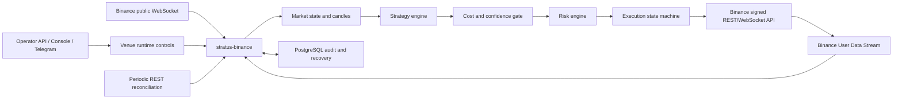

# Техническое задание: модуль непрерывной торговли Binance Spot для STRATUS

- Статус: проект ТЗ для согласования до начала реализации.
- Дата: 2026-07-12.
- Целевая система: текущий репозиторий STRATUS.
- Целевая площадка: Binance Spot, без маржи, фьючерсов, кредитования и шорта.

## 1. Ключевое ограничение и трактовка цели

Требование «как можно больше сделок, но только в плюс» невозможно принять буквально.
Ни стратегия, ни биржа, ни программный код не могут гарантировать положительный результат
каждой сделки. Запрет закрывать убыточные позиции не устраняет убыток, а превращает его в
неограниченный нереализованный риск. Увеличение числа сделок также увеличивает комиссии,
спред, проскальзывание и вероятность технической ошибки.

В этом ТЗ бизнес-цель формализуется следующим образом:

1. Сохранность капитала и корректность биржевого состояния имеют приоритет над доходностью.
2. Бот открывает сделку только тогда, когда оценённая доходность после всех ожидаемых затрат
   и запаса на ошибку положительна.
3. Среди таких возможностей система максимизирует число независимых исполненных сигналов,
   не ослабляя порог качества и риск-лимиты.
4. Убыточные сделки допустимы и должны быстро ограничиваться. Критерий успеха относится к
   статистически значимой серии сделок, а не к каждой отдельной сделке.
5. Если положительное математическое ожидание не доказано, корректный результат системы
   состоит в отсутствии live-сделок.

Основной критерий входа:

```text
net_edge_lcb_bps =
    lower_confidence_bound(expected_gross_return_bps)
    - entry_fee_bps
    - expected_exit_fee_bps
    - expected_spread_bps
    - expected_entry_slippage_bps
    - expected_exit_slippage_bps
    - latency_and_model_error_buffer_bps

trade_allowed = net_edge_lcb_bps > configured_min_net_edge_bps
```

`LCB` означает нижнюю доверительную границу, а не среднюю оптимистичную оценку.
Комиссии берутся из конкретного аккаунта и символа Binance. Порог не должен быть
захардкожен под стандартный тариф.

## 2. Назначение

Разработать в составе STRATUS второй независимый торговый контур `binance_spot`, который:

- работает круглосуточно как отдельный Docker-сервис;
- получает публичные рыночные данные и приватные события аккаунта в реальном времени;
- генерирует, фильтрует и исполняет spot-сигналы;
- поддерживает backtest, shadow, testnet и live без смешения данных и денег;
- ведёт fill-accurate учёт балансов, комиссий, позиций и P&L;
- восстанавливает состояние после перезапуска и сверяет его с биржей;
- использует общую операторскую инфраструктуру STRATUS, но отдельные venue-режимы,
  лимиты и live-gate;
- при любой неопределённости прекращает новые входы и сохраняет защиту уже открытой
  позиции.

## 3. Границы первой версии

### 3.1. Входит в объём

- Binance Spot.
- Режим позиции `long/flat`: покупка базового актива и продажа только реально доступного
  количества.
- Стартовый allowlist: `BTCUSDT` и `ETHUSDT`.
- `SOLUSDT` добавляется только после отдельного прохождения data/strategy gate.
- Сигнальный горизонт: внутридневной, базовый интервал принятия решения `5m`, контекст
  режима рынка `1h`.
- Рыночные данные: candles, best bid/ask, trades и глубина книги, необходимая для оценки
  исполнимости.
- Maker и taker исполнение с раздельной моделью затрат.
- Биржевые защитные выходы через поддерживаемые Binance order lists/OCO или отдельный
  stop-order, подтверждённый биржей.
- Полный аудит команд, сигналов, заявок, исполнений, комиссий и сверок.

### 3.2. Не входит в первую версию

- Margin, Futures, Options, Portfolio Margin и любое плечо.
- Короткие позиции и заём активов.
- DCA в убыточную позицию, мартингейл, сетка с увеличением лота, усреднение вниз.
- Арбитраж между биржами.
- Автоматические ввод и вывод средств.
- HFT, co-location, FIX/SBE и стратегии, требующие микросекундной задержки.
- Автоматическое изменение параметров live-стратегии без новой версии, backtest и gate.
- Одновременная ручная торговля на том же spot-аккаунте.
- Обещание фиксированной дневной/месячной доходности или стопроцентного win rate.

Market making исключён из первой версии: большое число fill не означает прибыль, а
корректное моделирование позиции в очереди, adverse selection и inventory risk требует
другой инфраструктуры и tick-level проверки.

## 4. Исходное состояние STRATUS и архитектурное решение

Текущие таблицы `markets`, `signals`, `orders` и `positions` описывают бинарные контракты
Polymarket: `BUY_YES/BUY_NO`, вероятность исхода, количество shares и settlement события.
Использовать эти таблицы для Binance запрещено. У spot-торговли другие инструменты,
статусы заявок, комиссии, балансы, частичные fills и логика закрытия.

Повторно используются проверенные системные принципы STRATUS:

- PostgreSQL как источник аудита и управляющего состояния;
- fail-closed live-gate;
- идемпотентность перед внешним вызовом;
- `kill switch`;
- «уменьшать до допустимого размера, никогда не увеличивать»;
- Telegram, operator API и WinUI console;
- health audit, job/event audit, резервное копирование;
- раздельные paper/live метрики.

Добавляется отдельный непрерывный процесс `stratus-binance`, чтобы сбой WebSocket или
биржевого адаптера не останавливал погодный pipeline и наоборот.



## 5. Обязательные системные инварианты

1. Polymarket и Binance имеют независимые режимы, gates, лимиты и halt reason.
2. Глобальный `/stop all` останавливает новые входы на обеих площадках.
3. `/stop binance` не меняет режим Polymarket.
4. Ни API, ни console, ни Telegram не получают торговый private key.
5. Торговый ключ доступен только процессу `stratus-binance`.
6. У API-ключа Binance отключены withdrawals, margin и futures; включён только Spot
   Trading и чтение аккаунта. Обязателен IP allowlist.
7. Перед внешней отправкой заявка фиксируется в БД с уникальным `clientOrderId`.
8. Timeout, HTTP 5xx или разрыв соединения после отправки означают `UNKNOWN`, а не
   `FAILED`. Повторная отправка без сверки запрещена.
9. Любой fill является фактом позиции, даже если локальная заявка ещё не получила
   финальный статус.
10. Любая ненулевая live-позиция должна иметь подтверждённую биржей защиту либо должна
    быть аварийно закрыта по утверждённой политике.
11. Kill switch отменяет новые entry orders, но не снимает stop-защиту открытых позиций.
12. Количество, цена и notional проходят актуальные filters из `/api/v3/exchangeInfo`.
13. Все денежные расчёты выполняются через `Decimal`, без `float` в order planning и
    бухгалтерии.
14. Размер заявки после округления может только уменьшиться.
15. Сигнал формируется только по закрытым candles; незакрытая свеча не используется как
    закрытая ни в backtest, ни в live.
16. Strategy version и risk-config version неизменяемо записываются в каждый signal и
    trade cycle.
17. Ручная или неизвестная заявка/позиция в выделенном аккаунте блокирует новые входы до
    reconciliation.
18. Успех API-вызова не считается fill. Истина об исполнении приходит из User Data Stream
    и подтверждается REST reconciliation.

## 6. Режимы эксплуатации

У Binance должен быть собственный state, не связанный с текущим общим `TRADING_MODE`:

| Режим | Рыночные данные | Заявки | Деньги | Назначение |
| --- | --- | --- | --- | --- |
| `disabled` | нет | нет | нет | модуль выключен |
| `backtest` | архив | симулятор | виртуальные | исследование стратегии |
| `shadow` | production WebSocket | локальный fill simulator | виртуальные | проверка на живом рынке |
| `testnet` | Binance Spot Testnet | реальные API-вызовы testnet | виртуальные Binance | проверка интеграции |
| `live` | production | production | реальные | торговля после gate |

Требования:

- переходы `disabled -> shadow` и `shadow -> testnet` доступны оператору;
- переход `testnet/shadow -> live` требует выполнения всех gates и двойного подтверждения
  в течение пяти минут;
- переход из `live` в `shadow` сначала блокирует входы и приводит локальное состояние в
  согласованное состояние; открытые live-позиции не должны «исчезать» из мониторинга;
- перезапуск процесса не изменяет режим;
- `live` никогда не выводится из `.env` как фактический runtime-state: `.env` задаёт
  только разрешённые endpoints и наличие credentials, а режим хранится в БД.

## 7. Управление площадками

Добавить обобщённую таблицу `venue_runtime_control`:

| Поле | Тип | Назначение |
| --- | --- | --- |
| `venue` | enum/PK | `polymarket`, `binance_spot` |
| `enabled` | bool | разрешён ли запуск контура |
| `mode` | enum | `disabled/backtest/shadow/testnet/live` |
| `kill_switch` | bool | venue stop |
| `halted_reason` | text nullable | неустранимая автоматически причина |
| `live_confirmation_until` | timestamptz | окно второго подтверждения |
| `strategy_version` | text nullable | активная версия стратегии |
| `risk_config_version` | text | активная версия лимитов |
| `last_reconciled_at` | timestamptz nullable | последняя успешная сверка |
| `updated_at` | timestamptz | аудит изменения |

Миграция должна сохранить текущее поведение Polymarket. До полной миграции текущая строка
`runtime_control` считается legacy-источником для Polymarket; Binance не имеет права её
использовать как свой mode switch.

Команды:

- `stop {venue: binance_spot|polymarket|all}`;
- `resume {venue: ...}`;
- `set_mode {venue: binance_spot, mode: shadow|testnet|live}`;
- `binance_reconcile`;
- `binance_cancel_entries`;
- `binance_flatten {confirmation_token}`.

`binance_flatten` является отдельной опасной командой: двойное подтверждение, свежая
reconciliation, оценка slippage, запись actor и причины. Обычный `stop` не должен слепо
продавать активы в неизвестном состоянии.

## 8. Binance API и адаптер

### 8.1. Клиент

Предпочтительный клиент: [официальный модульный Python SDK](https://developers.binance.com/en/docs/sdks-tools/connectors/python)
`binance-sdk-spot`. Все его типы инкапсулируются интерфейсом `BinanceSpotGateway`, чтобы
обновление SDK не затрагивало strategy/risk/accounting.

Минимальный интерфейс gateway:

```python
class BinanceSpotGateway(Protocol):
    async def ping(self) -> None: ...
    async def server_time(self) -> datetime: ...
    async def exchange_info(self, symbols: tuple[str, ...]) -> ExchangeInfo: ...
    async def account(self) -> AccountSnapshot: ...
    async def commission(self, symbol: str) -> CommissionSchedule: ...
    async def new_order(self, plan: OrderPlan) -> ExchangeOrderAck: ...
    async def new_oco(self, plan: ExitPlan) -> ExchangeOrderListAck: ...
    async def query_order(self, symbol: str, client_order_id: str) -> ExchangeOrder: ...
    async def cancel_order(self, symbol: str, client_order_id: str) -> ExchangeOrder: ...
    async def open_orders(self, symbol: str | None = None) -> list[ExchangeOrder]: ...
    async def account_trades(self, symbol: str, cursor: TradeCursor) -> list[ExchangeFill]: ...
```

SDK callback/thread boundaries не должны выполнять SQL. События преобразуются в локальные
immutable DTO и передаются в bounded async queue.

Поскольку REST-методы официального SDK синхронные, gateway не должен блокировать asyncio
event loop: вызовы выполняются через ограниченный worker pool либо заменяются поддерживаемым
асинхронным WebSocket API. Размер pool ограничен, а его saturation является health signal.

Встроенные общие retries SDK должны быть отключены для `new_order`, `new_oco` и других
неидемпотентных команд. После возможной отправки запроса timeout обрабатывается только как
`UNKNOWN` с query по `clientOrderId`. Автоматические retries разрешены лишь для явно
идемпотентных read-запросов и с соблюдением rate limits.

### 8.2. Используемые публичные данные

- `/api/v3/ping` и `/api/v3/time` для preflight и контроля часов;
- `/api/v3/exchangeInfo` для статуса символа, типов заявок, filters, STP и rate limits;
- `/api/v3/depth` для начального снимка локальной книги;
- klines REST только для bootstrap/gap fill;
- WebSocket `kline_1m`, `kline_5m`, `bookTicker`, `aggTrade` и diff depth;
- production public data разрешены в `shadow`;
- Testnet endpoints используются только в `testnet`.

Если локальная книга используется для slippage/depth, реализовать официальный алгоритм:
начать буферизацию diff events, получить REST snapshot, отбросить старые события, проверить
диапазон sequence IDs и затем применять только непрерывную последовательность. Любой gap
инвалидирует книгу и запускает повторный bootstrap. Пока книга invalid, новые входы запрещены.

### 8.3. Приватные данные

[User Data Stream](https://developers.binance.com/en/docs/products/spot/user-data-stream)
является основным realtime-каналом:

- `executionReport` обновляет заявку и создаёт fills;
- `outboundAccountPosition` обновляет возможные изменившиеся балансы;
- `balanceUpdate` фиксирует внешние движения/transfer;
- `listStatus` обновляет OCO/order-list;
- неизвестный event type сохраняется и поднимает warning до обновления parser.

События могут быть повторными или приходить после REST-ответа. Обработка обязана быть
идемпотентной и монотонной по exchange update/execution identifiers.

### 8.4. WebSocket lifecycle

- согласно [контракту Spot WebSocket Streams](https://developers.binance.com/en/docs/products/spot/web-socket-streams),
  production connection живёт не более 24 часов;
- плановый reconnect начинается до предельного срока, рекомендованно на 23-м часу;
- ping должен получать корректный pong с тем же payload;
- reconnect использует exponential backoff с jitter и верхней границей;
- после каждого reconnect запускается REST gap reconciliation;
- превышение лимита входящих control messages запрещено;
- число streams и connections контролируется централизованно;
- market-data и user-data connection имеют независимые health states;
- очередь событий bounded; overflow является critical, а не причиной тихо выбрасывать fills.

### 8.5. Rate limits

- лимиты считываются из `exchangeInfo`, а не копируются навсегда из
  [общей документации Spot REST](https://developers.binance.com/en/docs/products/spot/rest-api);
- REST gateway ведёт token buckets для `REQUEST_WEIGHT` и `ORDERS`;
- сохраняется не менее 20% аварийного резерва на cancel/query/reconciliation;
- заголовки `X-MBX-USED-WEIGHT-*` и `X-MBX-ORDER-COUNT-*` экспортируются в метрики;
- HTTP 429: немедленно остановить новые entry requests и соблюдать `Retry-After`;
- HTTP 418: venue halt, critical alert, никаких автоматических повторов до окончания ban и
  ручной проверки причины;
- публичные цены не опрашиваются REST в цикле, если доступен WebSocket;
- запрос всех open orders без символа не используется в частом polling из-за большего weight.

### 8.6. Подпись и время

- рекомендуемый тип production key: Ed25519, если он доступен аккаунту;
- `recvWindow` по умолчанию не более 5000 ms;
- offset к server time измеряется периодически;
- drift более 500 ms блокирует новые signed requests, кроме query/cancel, необходимых для
  снижения риска;
- drift более 1000 ms или repeated `-1021 INVALID_TIMESTAMP` включает venue kill switch;
- secret/private key не логируется, не возвращается API и не хранится в PostgreSQL.

## 9. Universe и инструменты

### 9.1. Allowlist

На старте разрешены только:

```text
BTCUSDT
ETHUSDT
```

Динамический выбор всех Binance symbols запрещён. Новый символ проходит отдельный gate:

- status `TRADING`;
- quote asset соответствует настройке аккаунта;
- доступны нужные order types и OCO/stop protection;
- достаточный объём и глубина;
- стабильный spread;
- не менее двух лет пригодной истории либо вся доступная история нового актива;
- отдельный out-of-sample результат;
- отсутствие delisting/operational warning, требующего ручного решения;
- лимит корреляционной группы обновлён.

### 9.2. Symbol filters

При старте, раз в шесть часов и после filter rejection обновлять актуальные
[symbol/exchange filters](https://developers.binance.com/en/docs/products/spot/filters):

- `PRICE_FILTER`;
- `LOT_SIZE`;
- `MARKET_LOT_SIZE`;
- `MIN_NOTIONAL` и/или `NOTIONAL`;
- `PERCENT_PRICE` / `PERCENT_PRICE_BY_SIDE`;
- `MAX_NUM_ORDERS`, exchange order limits;
- разрешённые order types, OCO/OTO/STP modes.

Filter cache имеет version/hash. Order plan хранит hash, по которому он был рассчитан.
Изменение filter между plan и submit требует перестроить план и повторно пройти risk check.

## 10. Рыночные данные

### 10.1. Сырые и агрегированные данные

Хранить:

- закрытые `1m`, `5m`, `15m`, `1h` candles;
- top-of-book snapshots с контролируемой частотой, например 1 секунда;
- агрегированные depth features, но не каждый raw delta бесконечно;
- spread, depth within N bps, imbalance, realised volatility;
- data gaps и source/recovery metadata.

Raw WebSocket payload может временно храниться для расследования, но retention должен быть
ограничен. Fills, orders и account events не удаляются обычной retention-задачей.

### 10.2. Исторический bootstrap

Для backtest использовать [официальный Binance Public Data archive](https://github.com/binance/binance-public-data)
с `.CHECKSUM`:

- минимум 24 месяца для BTC/ETH и по возможности более длинный период;
- klines плюс trades/aggTrades для калибровки slippage и maker-fill модели;
- timestamps после 2025-01-01 корректно интерпретировать как microseconds в архивных
  spot-файлах;
- сохранять SHA-256, URL, размер, период и время импорта;
- импорт идемпотентный;
- после архива заполнить хвост REST-данными и затем WebSocket;
- gap, duplicate и non-monotonic timestamp делают период непригодным до исправления.

### 10.3. Freshness gates

Новые входы запрещены, если выполнено хотя бы одно условие:

- последний `bookTicker` старше 2 секунд;
- текущий closed candle не появился через 5 секунд после ожидаемого close;
- локальная depth book invalid;
- spread/depth feature старше 2 секунд;
- обнаружен sequence gap;
- exchange symbol status не `TRADING`;
- system clock drift выше порога.

Порог freshness конфигурируемый, но его увеличение в live требует новой risk-config version.

## 11. Исследование и выбор стратегии

### 11.1. Принцип

ТЗ не объявляет заранее прибыльной конкретную комбинацию индикаторов. Реализация включает
исследовательский этап с правом результата `NO-GO`. В live попадает только версия, прошедшая
out-of-sample, cost stress, shadow и canary gates.

### 11.2. Кандидаты первой исследовательской итерации

1. `trend_pullback`: направление определяется на `1h`, вход после контролируемого отката и
   восстановления импульса на закрытой `5m` свече.
2. `range_mean_reversion`: используется только в статистически подтверждённом боковом режиме,
   с коротким time stop и запретом входа при расширении volatility/spread.
3. `volatility_breakout`: вход после сжатия volatility и подтверждённого breakout, если
   ожидаемое продолжение покрывает taker costs.

Индикаторные значения являются параметрами эксперимента, а не ручными live-настройками.
Нельзя выбирать лучший набор по единственному полному backtest. Нужен walk-forward.

### 11.3. Strategy contract

Каждая стратегия получает только данные, доступные на `decision_time`, и возвращает:

```text
symbol
decision_time
side = BUY or EXIT
horizon_seconds
expected_return_distribution
probability_target_before_stop
entry_policy = maker | taker_if_edge_survives
entry_price_cap
stop_trigger
take_profit_target
time_stop
signal_ttl
feature_snapshot_id
strategy_version
explanation_codes[]
```

Стратегия не определяет окончательный размер заявки и не вызывает Binance. Это делают cost
gate, risk engine и execution planner.

### 11.4. Regime gate

Стратегия должна явно классифицировать режим минимум как:

- `trend`;
- `range`;
- `high_volatility`;
- `illiquid_or_dislocated`;
- `unknown`.

В `unknown`, `illiquid_or_dislocated` и невалидном data state новые входы запрещены.
Параметры regime model версионируются и проверяются без look-ahead.

### 11.5. Запрещённые методы улучшения статистики

- удаление убыточных fills из отчёта;
- оптимизация на final holdout;
- выбор только выгодных дат/символов после просмотра результата;
- использование будущего high/low внутри свечи при входе на её close;
- предположение, что limit maker fill произошёл только потому, что candle коснулась цены;
- нулевая комиссия или постоянный spread;
- бесконечное удержание убыточной позиции;
- увеличение риска после убытка;
- объединение testnet fills с shadow P&L как одного доказательства edge.

## 12. Cost model и решение о входе

До каждой сделки рассчитываются и сохраняются:

- фактические maker/taker commission rates аккаунта;
- возможная special/tax commission;
- ожидаемый fee asset и его стоимость в quote asset;
- текущий spread;
- ожидаемый market impact по локальной книге;
- модель slippage по size/depth/volatility/session;
- вероятность maker fill и adverse selection после fill;
- стоимость аварийного taker exit;
- model uncertainty buffer;
- итоговый `net_edge_lcb_bps`.

Для protective stop всегда используется консервативная taker/slippage оценка. Maker discount
не разрешено применять к leg, который при неблагоприятном движении станет taker.

Допуск сигнала:

```text
expected_net_pnl_quote =
    position_notional * net_edge_lcb_bps / 10_000

expected_net_pnl_quote > 0
net_edge_lcb_bps >= min_net_edge_bps
expected_net_pnl_quote >= min_absolute_edge_quote
reward_to_tail_risk >= configured_floor
all_data_and_risk_gates_passed
```

`min_absolute_edge_quote` не позволяет открывать сделки, у которых теоретический плюс
меньше ошибки округления/учёта.

## 13. Position sizing

Размер определяется минимумом всех ограничений:

```text
qty_by_stop_risk = equity * max_risk_fraction / stop_distance_quote
qty_by_symbol_cap = remaining_symbol_exposure / entry_price
qty_by_total_cap = remaining_total_exposure / entry_price
qty_by_depth = executable_depth_at_slippage_limit * participation_limit
qty_by_cash = free_quote_balance_after_reserve / entry_price
qty_by_absolute_cap = max_order_quote / entry_price

planned_qty = floor_to_step_size(min(all_limits))
```

После округления заново проверяются notional, stop risk и ожидаемый P&L. Если minimum notional
требует увеличить заявку, сигнал отклоняется. Автоматически увеличивать размер запрещено.

## 14. Стартовые риск-профили

Значения ниже являются верхними границами для первого запуска и должны быть уточнены после
backtest с фактическим капиталом. Более строгие значения разрешены без повторного strategy
gate; ослабление требует новой risk-config version и подтверждения.

| Лимит | Shadow/Testnet | Live canary | Live после scale gate |
| --- | ---: | ---: | ---: |
| Риск до stop на цикл | 0.10% equity | 0.10% equity | не более 0.25% equity |
| Notional одного входа | 5% equity | min(2% equity, 25 USDT) | не более 5% equity |
| Экспозиция одного символа | 10% | 3% | 5% |
| Общая crypto-экспозиция | 25% | 5% | 15% |
| Участие в видимой depth | 5% | 2% | 5% |
| Дневной stop, realised + unrealised | 2% | 1% | 1.5% |
| Недельный stop | 5% | 3% | 4% |
| Drawdown от high-water mark | 10% | 6% | 8% |
| Открытых entry orders на символ | 1 | 1 | 1 |
| Незащищённая позиция | 0 | 0 | 0 |

Дополнительные правила:

- BTC, ETH и SOL входят в одну корреляционную risk group;
- новый вход запрещён, если worst-case loss всех stops превышает общий лимит;
- дневной лимит учитывает realised и unrealised P&L, fees и reserved losses;
- после пяти последовательных stop-outs по одной стратегии включается cooldown до ручной
  проверки либо минимум на шесть часов;
- после восьми stop-outs на всех symbols включается venue kill switch;
- time stop обязателен: позиция не становится долгосрочной инвестицией из-за ошибки стратегии;
- dust не считается открытой торговой позицией, но учитывается в балансе и отчёте;
- депозит/вывод/ручной transfer во время live вызывает reconciliation hold.

## 15. Исполнение entry

### 15.1. Политики

`maker` по умолчанию:

- `LIMIT_MAKER` на безопасной стороне книги;
- TTL, стартово 15-30 секунд;
- максимум одна контролируемая repricing попытка;
- repricing не пересекает `entry_price_cap` и не уничтожает net edge;
- отсутствие fill означает `missed`, а не повод догонять рынок.

`taker_if_edge_survives`:

- разрешён только если net edge пересчитан с taker fee и worst-case slippage;
- используется market или marketable limit с price protection;
- до отправки проверяется depth для полного ожидаемого объёма;
- проскальзывание выше лимита блокирует вход.

### 15.2. Idempotency

Формат client id должен быть короче лимита Binance и включать локальный intent:

```text
stb-{env}-{base32_intent_id}-{leg}
```

Примеры leg: `e` entry, `t` take profit, `s` stop, `c` cancel.

Последовательность:

1. В транзакции заблокировать signal/intent.
2. Повторно проверить mode, kill switch, freshness, risk и balances.
3. Создать локальную заявку `submitting` с уникальным client id.
4. Commit.
5. Отправить запрос Binance.
6. Записать ack/rejection либо `submit_unknown`.
7. При `submit_unknown` не повторять запрос; сначала User Data Stream, затем `GET order` по
   client id. Это следует из [семантики Spot REST timeout/5xx](https://developers.binance.com/en/docs/products/spot/rest-api),
   где результат исполнения может оставаться неизвестным.
8. Если состояние всё ещё неизвестно, venue halt и critical alert.

## 16. Частичные исполнения и защитный выход

Позиция строится по fills, а не по requested order quantity.

Для maker entry:

1. Каждый partial fill немедленно увеличивает локальный inventory.
2. По истечении TTL остаток entry отменяется.
3. Система дожидается подтверждения cancel/final order state.
4. Для реально доступного количества, уменьшенного на возможную base-asset commission и
   округлённого вниз, ставится OCO/protective exit.
5. До подтверждения защиты новые входы по символу запрещены.

Целевой SLO: от первого fill до подтверждённой exchange-side защиты не более 5 секунд.
Более 10 секунд является critical. Если OCO/stop невозможно поставить:

- немедленно venue stop;
- попытка отдельного protective stop;
- если stop отклонён и состояние достоверно, аварийный market/marketable-limit exit в рамках
  утверждённой политики;
- если состояние недостоверно, сначала reconciliation и операторский critical alert.

OTOCO разрешается только после отдельного теста partial-fill поведения. Нельзя считать
позицию защищённой, пока pending exits фактически не появились на бирже.

## 17. Выходы и trade cycle

Поддерживаются причины выхода:

- `take_profit`;
- `protective_stop`;
- `time_stop`;
- `signal_invalidation`;
- `risk_flatten`;
- `operator_flatten`;
- `exchange_symbol_halt_recovery`.

После заполнения одной OCO-leg вторая должна быть отменена Binance и подтверждена через
`listStatus`/REST. Локально закрытый cycle создаётся только из fills. Cancel ack без fill не
закрывает позицию.

Продажа не может превысить `free + locked` inventory, принадлежащий стратегии. При недостатке
quantity из-за комиссии план уменьшается. Если после уменьшения notional ниже биржевого
минимума, остаток маркируется `dust` и не вызывает повторяющиеся ошибки.

## 18. Состояния заявок

Локальная state machine должна сохранять exchange status и более строгий внутренний статус:

```text
planned
  -> submitting
  -> new
  -> partially_filled
  -> filled
  -> cancel_requested
  -> canceled
  -> rejected
  -> expired
  -> expired_in_match
  -> submit_unknown
  -> reconcile_required
```

Терминальные состояния не откатываются назад. Поздний fill/event может добавить факт
исполнения и инициировать позицию, даже если локальный status был ошибочно сочтён terminal;
это создаёт reconciliation incident и venue halt.

Отдельно хранить:

- exchange `orderId`, `orderListId`, `clientOrderId`;
- `executionReport` execution type/status;
- cumulative base и quote quantities;
- prevented quantity и STP events;
- reject code/message;
- request/ack/event timestamps;
- raw payload hash и parser version.

## 19. Self Trade Prevention

- На символе читать `allowedSelfTradePreventionModes`.
- Предпочитать `EXPIRE_TAKER` или более строгий допустимый mode, утверждённый execution
  policy.
- Не отправлять неподдерживаемый mode.
- `TRADE_PREVENTION`, `preventedQuantity` и `EXPIRED_IN_MATCH` являются штатными состояниями,
  а не fills.
- Повторяющиеся prevented matches означают ошибку lifecycle/ownership и блокируют символ.
- Запрещены wash trading, spoofing и заявки без намерения исполнения.

## 20. Reconciliation и восстановление

### 20.1. Startup sequence

При каждом запуске `stratus-binance`:

1. Установить runtime state `reconciling`; новые входы запрещены.
2. Проверить credentials, environment, server time и permissions.
3. Загрузить `exchangeInfo` и commissions.
4. Получить account balances.
5. Получить open orders по allowlist symbols.
6. Получить trades после последнего подтверждённого cursor.
7. Сопоставить orders/fills/order lists с БД.
8. Восстановить inventory lots, protected exits и P&L.
9. Классифицировать differences.
10. Только при отсутствии blocking differences установить `ready`.

### 20.2. Периодическая сверка

- каждые 30 секунд: open orders по активным symbols, balances и protection state;
- каждые 5 минут: trades from cursor и полный локальный consistency check;
- раз в сутки: полный отчёт orders/fills/balances/P&L;
- сразу после WebSocket reconnect, timeout, 5xx, cancel-replace partial success, filter change,
  неизвестного event или process crash recovery.

### 20.3. Классы расхождений

| Расхождение | Реакция |
| --- | --- |
| Exchange fill отсутствует локально | импортировать идемпотентно, пересчитать inventory; critical |
| Локальная open order отсутствует на бирже | query history; исправить terminal state |
| Неизвестная exchange order | venue halt; ручное принятие/отмена |
| Balance отличается только на fee/dust tolerance | пересчитать и warning |
| Balance отличается выше tolerance | venue halt |
| Позиция без stop/OCO | немедленная защита или flatten; critical |
| Две exit orders могут продать один inventory | cancel/reconcile; critical |
| Cursor gap | backfill REST, trading hold |

Tolerance задаётся в units конкретного asset/step size, а не одной общей суммой для всех
активов.

## 21. Учёт, inventory и P&L

Binance Spot не предоставляет абстракцию «позиция стратегии» так же, как фьючерсная биржа.
STRATUS строит её из fills и выделенного аккаунта.

Требования:

- отдельный Binance subaccount или отдельный аккаунт только для этого бота;
- fill уникален минимум по `(account, symbol, trade_id)`;
- хранить native commission amount и commission asset;
- сохранять стоимость комиссии в quote asset по цене на момент fill;
- поддерживать FIFO lots для налогового экспорта и weighted-average view для оперативного
  P&L, не смешивая методы;
- realized P&L возникает только на matched sell quantity;
- unrealized P&L считается по executable exit price, а не по last price без spread;
- equity включает free/locked quote, mark-to-market inventory и комиссии;
- deposits/withdrawals/transfers отделяются от trading P&L;
- dust показывается отдельно;
- P&L отчёт должен сходиться с fills и balances с объяснимым residual.

Формула цикла:

```text
gross_pnl_quote = sell_quote_received - matched_buy_cost_quote
net_pnl_quote = gross_pnl_quote - entry_fees_quote - exit_fees_quote
return_on_cost = net_pnl_quote / matched_buy_cost_quote
implementation_shortfall_bps =
    signed(fill_vwap - decision_reference_price) / decision_reference_price * 10_000
```

## 22. Схема данных

Все таблицы имеют `created_at`, при необходимости `updated_at`, immutable audit fields и
индексы по symbol/time/status.

### 22.1. Справочники и рынок

- `crypto_symbols`: venue, symbol, base/quote assets, status, permissions, filters JSON,
  filter hash, precision, enabled.
- `crypto_candles`: symbol, interval, open time, OHLCV, quote volume, trades, taker volumes,
  closed, source, unique identity.
- `crypto_market_snapshots`: best bid/ask, quantities, spread, depth, imbalance, sequence,
  validity, event time.
- `crypto_data_gaps`: stream, symbol, interval, expected/actual cursor, resolution status.

### 22.2. Strategy и execution

- `crypto_strategy_versions`: immutable code/config/data hash, approval status.
- `crypto_feature_snapshots`: feature values и source cursors на decision time.
- `crypto_signals`: strategy, symbol, action, forecasts, costs, net edge, reasons, status, TTL.
- `crypto_trade_intents`: desired cycle, risk budget, stop/target/time stop, state.
- `crypto_orders`: local/exchange IDs, order list, leg, side/type/TIF, quantities, prices,
  status, timestamps, errors, mode.
- `crypto_order_events`: immutable parsed/raw event audit.
- `crypto_fills`: trade id, price, quantity, quote quantity, fee, fee asset, maker flag, time.
- `crypto_exit_protections`: position quantity, stop/target, exchange order IDs, confirmed state.

### 22.3. Учёт и риск

- `crypto_inventory_lots`: acquired/remaining quantity, cost basis, fill link.
- `crypto_trade_cycles`: entry/exit aggregates, gross/net P&L, MAE/MFE, exit reason.
- `crypto_balance_snapshots`: free/locked by asset and source.
- `crypto_equity_snapshots`: equity, cash, inventory, realised/unrealised P&L, drawdown.
- `crypto_risk_snapshots`: exposure, worst-case stop loss, cap utilisation.
- `crypto_risk_events`: rule, observed value, limit, action.
- `crypto_reconciliation_runs` и `crypto_reconciliation_issues`.

### 22.4. Research

- `crypto_dataset_versions`: source files/checksums/gaps.
- `crypto_backtest_runs`: code/config/data hashes, train/validation/test periods, costs.
- `crypto_backtest_trades`: simulated decisions/fills/cycles.
- `crypto_validation_checkpoints`: metrics, thresholds, pass/fail reasons.

Money/price/quantity columns используют `NUMERIC` с precision, покрывающей Binance strings.
Raw JSON не заменяет нормализованные ключевые поля.

## 23. Конфигурация

Минимальный набор настроек:

```text
BINANCE_ENABLED=false
BINANCE_ENV=shadow
BINANCE_REST_URL=https://api.binance.com
BINANCE_WS_URL=wss://stream.binance.com:9443
BINANCE_TESTNET_REST_URL=https://testnet.binance.vision
BINANCE_TESTNET_WS_URL=wss://stream.testnet.binance.vision/ws
BINANCE_SYMBOLS=BTCUSDT,ETHUSDT
BINANCE_QUOTE_ASSET=USDT
BINANCE_API_KEY=
BINANCE_PRIVATE_KEY_FILE=
BINANCE_RECV_WINDOW_MS=5000
BINANCE_MAX_CLOCK_DRIFT_MS=500
BINANCE_RECONCILE_SECONDS=30
BINANCE_MARKET_DATA_STALE_MS=2000
BINANCE_ENTRY_TTL_SECONDS=20
BINANCE_MIN_NET_EDGE_BPS=
BINANCE_MIN_ABSOLUTE_EDGE_USDT=
BINANCE_MAX_ORDER_USDT=25
BINANCE_MAX_RISK_FRACTION=0.001
BINANCE_MAX_SYMBOL_EXPOSURE=0.03
BINANCE_MAX_TOTAL_EXPOSURE=0.05
BINANCE_DAILY_LOSS_LIMIT=0.01
BINANCE_WEEKLY_LOSS_LIMIT=0.03
BINANCE_MAX_DRAWDOWN=0.06
BINANCE_LIVE_LEGAL_APPROVED=false
BINANCE_LIVE_TAX_APPROVED=false
BINANCE_LIVE_SECURITY_APPROVED=false
```

Правила:

- production URL и testnet URL не выводятся из одного boolean без явной environment config;
- live credentials не принимаются в test fixtures;
- пустой `BINANCE_MIN_NET_EDGE_BPS` вычисляется из cost/uncertainty policy, а не означает 0;
- secrets не помещаются в `.env.example` как реальные значения;
- production secret предпочтительно передаётся как read-only mounted secret file;
- изменение live-risk настроек фиксируется как новая `risk_config_version`.

## 24. Preflight

Команда `stratus-binance-preflight` не размещает заявку и завершается non-zero, если:

- выбранный environment не соответствует credentials;
- API недоступен;
- server clock drift выше порога;
- account `canTrade` false;
- `order/test` не подтверждает нужное Spot Trade permission;
- отсутствует аудируемое ручное подтверждение Binance API Management, что withdrawal,
  margin и futures permissions выключены, а IP restriction включён;
- symbol не `TRADING`;
- нужные order types/OCO/STP не поддерживаются;
- filters не распознаны;
- commission schedule не получен;
- balance/reconciliation не согласованы;
- уже есть неизвестные open orders;
- live legal/tax/KYC approvals не выставлены для live preflight.

`canWithdraw` в account payload описывает возможность аккаунта и не доказывает, что право
withdrawal включено у конкретного API key. Поэтому `BINANCE_LIVE_SECURITY_APPROVED` может
выставить только оператор после проверки настроек ключа; код не должен подменять эту проверку
косвенным полем API.

Дополнительно реализовать `order/test` dry-run для формы entry, когда endpoint/environment
это поддерживает. Успех test order не заменяет проверку реального lifecycle в Testnet.

## 25. Безопасность и организационные требования

До live оператор обязан подтвердить:

- Binance обслуживает его страну проживания и тип аккаунта;
- KYC завершён и использование API разрешено условиями аккаунта;
- налоговый порядок для trades, fees и transfers определён;
- выбран выделенный аккаунт/subaccount;
- API key имеет только read + Spot Trade;
- withdrawals, margin и futures выключены;
- настроен IP allowlist со статическим outbound IP;
- включены 2FA и уведомления аккаунта;
- определён порядок немедленной ротации/revoke ключа;
- запрещена ручная торговля в выделенном аккаунте;
- стратегия не реализует manipulation/wash trading/spoofing.

STRATUS не выставляет legal/tax approval автоматически. Эти флаги являются ручным
подтверждением оператора, но не юридическим заключением.

## 26. Непрерывная работа и deployment

В `docker-compose.yml` добавить сервис:

```yaml
binance-worker:
  image: stratus:local
  command: ["stratus-binance"]
  restart: unless-stopped
  depends_on:
    migrate:
      condition: service_completed_successfully
```

Фактическая конфигурация должна передавать Binance secrets только этому сервису, а не через
общий environment anchor, который получают API и обычный worker.

Внутри процесса работают supervised async loops:

- market WebSocket;
- User Data Stream;
- candle/feature aggregation;
- signal evaluation;
- execution state machine;
- protection monitor;
- reconciliation;
- risk/equity snapshot;
- notification outbox.

Падение критической loop завершает процесс non-zero после записи halt reason. Docker
перезапускает процесс, но startup reconciliation не позволяет сразу продолжить торговлю.

Health endpoints должны различать:

- process liveness;
- market stream connectivity;
- user stream connectivity;
- last event age;
- order book validity;
- reconciliation status;
- protection coverage;
- rate-limit headroom;
- trading readiness.

## 27. Отказоустойчивость

| Событие | Обязательное поведение |
| --- | --- |
| REST timeout/5xx после submit | status unknown, query by client id, без resend |
| WebSocket market disconnect | блок новых входов, reconnect, gap fill |
| User Data disconnect | блок новых входов, REST reconciliation; exits остаются на бирже |
| PostgreSQL недоступен | никаких новых внешних команд; exchange stops не отменять |
| Процесс упал после DB commit до submit | startup проверяет `submitting`; query, не resend вслепую |
| Процесс упал после submit до ack | query по client id и trades; halt до ясности |
| Clock drift | блок signed entry, sync/recheck, alert |
| 429 | pause и Retry-After |
| 418 | venue halt до ручного аудита |
| Symbol trading halt | запрет новых orders, сохранить/сверить protection, alert |
| Filter changed | invalidate plans, refresh exchangeInfo |
| OCO rejected | protective fallback/flatten и venue halt |
| Balance mismatch | reconciliation hold |
| Duplicate/out-of-order event | idempotent apply, monotonic state |
| Queue overflow | critical halt, ничего не выбрасывать тихо |
| Quote asset dislocation | risk halt по отдельной утверждённой политике |

## 28. Operator API, Console и Telegram

### 28.1. API

Добавить read-only endpoints:

- `GET /api/v1/venues`;
- `GET /api/v1/binance/overview`;
- `GET /api/v1/binance/symbols`;
- `GET /api/v1/binance/signals`;
- `GET /api/v1/binance/orders`;
- `GET /api/v1/binance/fills`;
- `GET /api/v1/binance/positions`;
- `GET /api/v1/binance/trade-cycles`;
- `GET /api/v1/binance/equity`;
- `GET /api/v1/binance/risk`;
- `GET /api/v1/binance/reconciliation`;
- `GET /api/v1/binance/strategy-validation`.

Все mutation проходят только через существующую audited command queue. `X-API-Key`
обязателен при любом доступе не с loopback. Ни один response не содержит credentials или
полные raw signed requests.

### 28.2. Console

Добавить venue selector и отдельную Binance workspace:

- mode, gate, kill switch и readiness;
- equity, realised/unrealised P&L и drawdown;
- free/locked balances;
- текущий inventory и exchange-side protection;
- signals с gross/cost/net edge;
- orders, partial fills, fees и implementation shortfall;
- risk cap utilisation;
- reconciliation issues;
- strategy version и validation history.

Polymarket Brier/CLV метрики не показывать как Binance KPI. Для Binance вместо них нужны
net expectancy, profit factor, drawdown, fill quality и calibration ожидаемой доходности.

### 28.3. Telegram

Команды администратора:

- `/binance_status`;
- `/binance_daily`;
- `/binance_stop`;
- `/binance_resume`;
- `/binance_mode shadow|testnet|live`;
- `/binance_reconcile`;
- `/binance_flatten` с двойным подтверждением.

События высокой важности:

- live entry/fill/exit;
- stop loss;
- position without protection;
- submit unknown;
- reconciliation mismatch;
- daily/weekly/drawdown breach;
- 429/418;
- WebSocket outage сверх SLO;
- mode/risk/strategy change;
- key/preflight failure.

## 29. KPI и измерение результата

### 29.1. Основные KPI

1. `Net expectancy per completed cycle` в bps и quote currency. Gate использует 95%
   bootstrap lower bound, который должен быть выше нуля.
2. `Net return / max drawdown` и абсолютный max drawdown. Доходность без риска не является
   достаточной.
3. `Reconciled net P&L`: P&L должен сходиться с exchange fills/balances, а необъяснимый
   residual должен быть ниже установленного tolerance.

### 29.2. Driver metrics

- eligible signals;
- executed eligible signals;
- opportunity utilisation;
- maker fill rate;
- median/p95 time to fill;
- implementation shortfall;
- fee, spread и slippage bps;
- protection placement latency;
- signal decay между decision и fill;
- expectancy по symbol, strategy, regime и session.

Число сделок является только driver metric. Увеличение trade count при ухудшении net
expectancy считается деградацией.

### 29.3. Guardrails

- max drawdown;
- daily/weekly loss;
- expected shortfall/CVaR;
- largest trade contribution;
- largest five trades contribution;
- profit concentration по symbol/regime;
- unknown orders = 0;
- unprotected positions = 0;
- unresolved reconciliation issues = 0;
- 429/418 count;
- data completeness/freshness.

Win rate является диагностикой, но не gate. Стратегия с win rate ниже 50% может быть
прибыльной при положительном payoff, а высокий win rate может скрывать редкие крупные убытки.

## 30. Backtest и anti-overfitting gate

Backtest обязан:

- быть event-driven и воспроизводимым по data/code/config hash;
- использовать только информацию, доступную к decision time;
- моделировать partial fills, queue uncertainty и missed maker entries;
- включать фактические/консервативные fees, spread, slippage и latency;
- учитывать delisting/status/filter changes;
- разделять train, validation, walk-forward test и финальный untouched holdout;
- считать метрики по symbols, regimes и временным периодам;
- выполнять bootstrap confidence intervals;
- тестировать соседние параметры и неустойчивость результата;
- выполнять stress с 2x baseline slippage и неблагоприятным fee tier;
- исключать survivorship и look-ahead bias.

Минимальный gate для кандидата, до shadow:

- не менее 500 out-of-sample completed cycles суммарно;
- не менее 100 out-of-sample cycles на каждый live-symbol;
- net P&L > 0 на final holdout;
- 95% bootstrap LCB mean net expectancy > 0;
- profit factor >= 1.20;
- Sharpe >= 1.0 и Calmar >= 1.0 как вспомогательные метрики;
- max drawdown <= 8%;
- robust P&L остаётся положительным без пяти лучших cycles;
- пять лучших cycles дают менее 25% total net P&L;
- 2x slippage stress не делает итог явно отрицательным;
- положительный результат не сосредоточен в одном symbol или одном коротком режиме;
- параметрическое плато, а не одиночный оптимум.

Пороговые значения пересматриваются только до просмотра final holdout либо через новую
полностью отложенную выборку.

## 31. Shadow и Testnet gates

[Spot Testnet](https://developers.binance.com/en/docs/products/spot/testnet/rest-api) проверяет
API mechanics, но не доказывает реальную доходность или liquidity. Shadow на production data
проверяет стратегию и execution model, но не доказывает фактический fill. Для live нужны оба
контура.

### 31.1. Testnet gate

- не менее 7 непрерывных суток;
- успешны entry, partial fill, cancel, OCO/stop, take profit и reconciliation;
- пройден плановый 24-hour WebSocket reconnect;
- process/DB restart не создаёт duplicate order;
- неизвестные orders/fills после reconciliation: 0;
- unprotected positions: 0;
- все failure injection scenarios имеют ожидаемую реакцию;
- kill switch и cancel path проверены.

### 31.2. Shadow gate

- не менее 30 календарных суток и разных market regimes;
- не менее 300 completed cycles либо продление до достижения sample;
- net P&L после полной cost model > 0;
- 95% bootstrap LCB net expectancy > 0;
- profit factor >= 1.15;
- max drawdown <= 5%;
- robust P&L без пяти лучших cycles > 0;
- simulated maker fill model откалиброван по наблюдаемым trades/depth;
- data completeness closed `1m` candles >= 99.9%;
- нет unresolved critical health/reconciliation issues.

## 32. Live canary и масштабирование

Live включается только после backtest, shadow, testnet, security и legal/tax/KYC gates.

### 32.1. Canary

- максимум `min(2% equity, 25 USDT)` на entry;
- total exposure <= 5% equity;
- только `BTCUSDT`, затем `ETHUSDT` после успешных первых 50 cycles;
- минимум 14 суток и 100 completed live cycles;
- ручной review первых 10 cycles;
- daily loss limit 1%, drawdown halt 6%;
- любое `submit_unknown`, unprotected position или material reconciliation mismatch
  останавливает canary.

### 32.2. Scale gate

Перед увеличением лимитов:

- не менее 200 live cycles;
- reconciled net P&L > 0;
- net expectancy LCB > 0 либо sample продолжает на canary до достоверности;
- live implementation shortfall не хуже shadow assumption сверх tolerance;
- profit factor >= 1.10;
- drawdown в рамках canary limit;
- нет зависимости результата от одной сделки;
- оператор утверждает новую risk-config version.

Увеличение делается ступенями. Автоматическое увеличение размера после хорошей серии
запрещено.

## 33. Тестирование

### 33.1. Unit tests

- parsing всех используемых Binance events/responses;
- Decimal rounding по каждому filter;
- запрет увеличения quantity для min notional;
- fee conversion для quote/base/BNB;
- cost/net-edge calculation;
- position sizing и correlated caps;
- order/intent/protection state machines;
- duplicate и out-of-order events;
- P&L/FIFO lots/dust;
- loss/drawdown gates;
- client id uniqueness;
- mode и kill switch isolation между venues.

### 33.2. Integration tests с PostgreSQL и fake exchange

- persist-before-submit;
- crash до/после network call;
- timeout unknown;
- reject без halt, когда order точно не принят;
- partial fill, cancel, OCO на фактическое quantity;
- late fill после cancel request;
- duplicate execution report;
- fee в разных assets;
- unknown exchange order;
- balance mismatch;
- stop/OCO rejection;
- startup recovery;
- global stop и venue stop;
- parallel Polymarket/Binance operation.

### 33.3. Contract/Testnet tests

- реальные shape fixtures из актуального API;
- ping/time/exchangeInfo/account/commission;
- test order и live testnet order;
- query/cancel/open orders/myTrades;
- User Data Stream и order list events;
- WebSocket reconnect и REST gap recovery;
- rate limit header parser;
- unsupported/unknown field forward compatibility.

### 33.4. Chaos scenarios

- network loss на 1/10/60 секунд;
- DNS/TLS failure;
- 429 + Retry-After и 418;
- DB restart;
- container kill в каждой критической точке lifecycle;
- stale/duplicated WebSocket data;
- depth sequence gap;
- clock drift;
- symbol status/filter change;
- очередь событий заполнена;
- API key revoked;
- ручная неизвестная заявка.

## 34. Нефункциональные требования и SLO

- Market data availability: >= 99.9% closed 1m candles за rolling 30 days.
- Decision pipeline p95: <= 1 секунда после закрытия 5m candle.
- User event persistence p95: <= 1 секунда после получения.
- Protection confirmation: <= 5 секунд после первого fill; critical после 10 секунд.
- Reconciliation freshness в live: <= 60 секунд.
- Unknown order outcome: 0 перед новым entry.
- Unprotected live inventory: 0.
- Duplicate external order из одного intent: 0.
- P&L unexplained residual: 0 выше asset-specific tolerance.
- Recovery после process restart: без новых входов до полной reconciliation.
- Логи structured JSON, correlation IDs: venue/symbol/intent/order/client order/event.
- Prometheus-совместимые метрики либо эквивалентный текущему стеку endpoint.
- Orders/fills/risk/control audit не удаляются обычным retention.
- Daily backup включает новые таблицы и проверяется restore test.

## 35. Этапы реализации

### Этап B0. Решения и доступ

- страна/тип аккаунта/KYC/legal/tax подтверждены;
- выделен subaccount и статический IP;
- утверждены капитал, quote asset и canary limits;
- создана testnet credential pair, production key ещё не требуется.

### Этап B1. Venue isolation и schema

- `venue_runtime_control`;
- Binance таблицы и migrations;
- команды с venue scope;
- тесты, доказывающие отсутствие влияния на Polymarket.

### Этап B2. Market data и historical dataset

- SDK gateway;
- WebSocket lifecycle;
- exchangeInfo/filter cache;
- candles/book/depth storage;
- archive importer/checksums/gap audit.

### Этап B3. Backtest и strategy research

- event-driven simulator;
- cost/fill model;
- candidate strategies;
- walk-forward/holdout/robustness reports;
- решение GO/NO-GO.

### Этап B4. Testnet execution

- keys/signing/preflight;
- order state machine;
- partial fills/OCO/stops;
- user stream;
- reconciliation/recovery;
- chaos tests.

### Этап B5. Shadow, risk и accounting

- production market shadow;
- fill/P&L/inventory;
- risk profiles;
- 30-day checkpoint;
- validation report.

### Этап B6. Operator surfaces

- API;
- Telegram;
- WinUI Binance workspace;
- health/risk/reconciliation alerts.

### Этап B7. Live canary

- production security preflight;
- double confirmation;
- первые ограниченные orders;
- 14-day/100-cycle review;
- решение continue/halt.

### Этап B8. Controlled scale

- 200+ live cycles;
- новая risk-config version;
- ступенчатое расширение symbols/capital только через gate.

## 36. Definition of Done

Модуль считается реализованным, но ещё не обязательно допущенным в live, когда:

- Polymarket продолжает проходить существующие тесты;
- Binance имеет отдельные schema, mode, kill switch и halt reason;
- полный order/fill/protection lifecycle работает в Testnet;
- restart/reconciliation не создаёт duplicate orders;
- фильтры, fees и rate limits берутся динамически;
- все live calculations используют Decimal;
- открытая позиция не остаётся без exchange-side protection;
- P&L полностью восстанавливается из fills;
- backtest воспроизводим и исключает look-ahead;
- shadow/Testnet/live данные строго разделены;
- API/Console/Telegram показывают venue, strategy version и реальные причины блокировки;
- security checklist пройден;
- test suite, failure injection и restore test зелёные;
- документация содержит runbook запуска, остановки, ротации ключа и восстановления.

Live считается разрешённым только при отдельном выполнении всех gates разделов 30-32.
Положительный backtest без shadow/Testnet не является разрешением.

## 37. Решения, которые должен утвердить оператор

До этапа B4 необходимо зафиксировать:

1. Страна проживания, тип Binance аккаунта и фактическая доступность Spot API.
2. Размер отдельного торгового капитала.
3. Допустимый максимальный drawdown в валюте и процентах.
4. Выделенный аккаунт или subaccount.
5. Quote asset: `USDT`, `USDC` или иной разрешённый вариант.
6. Включена ли оплата комиссии BNB и допустим ли отдельный BNB inventory.
7. Разрешены ли taker entries, когда edge покрывает worst-case costs.
8. Политика при невозможности поставить stop: немедленный market exit или protected hold
   до reconciliation.
9. Статический outbound IP и способ хранения Ed25519 private key.
10. Налоговый формат экспорта и метод cost basis для юрисдикции оператора.

Пока ответы не зафиксированы, используются самые строгие значения, production key не
подключается, а режим `live` остаётся технически недоступным.

## 38. Официальные источники

Проверено 2026-07-12:

- [Binance Developer Documentation](https://developers.binance.com/en/docs/introduction)
- [General Spot REST API Information](https://developers.binance.com/en/docs/products/spot/rest-api)
- [Spot WebSocket Streams](https://developers.binance.com/en/docs/products/spot/web-socket-streams)
- [Spot User Data Stream](https://developers.binance.com/en/docs/products/spot/user-data-stream)
- [Spot symbol and exchange filters](https://developers.binance.com/en/docs/products/spot/filters)
- [Spot API errors](https://developers.binance.com/en/docs/products/spot/errors)
- [Spot Testnet REST API](https://developers.binance.com/en/docs/products/spot/testnet/rest-api)
- [Official Python connector](https://developers.binance.com/en/docs/sdks-tools/connectors/python)
- [Official Binance public historical data repository](https://github.com/binance/binance-public-data)
- [Official Binance Python SDK repository](https://github.com/binance/binance-connector-python)

Перед production deployment changelog и актуальные account-specific filters/permissions
проверяются повторно. Документация Binance и доступность продуктов могут изменяться.

## 39. Статус реализации на 2026-07-12

Завершён этап B1:

- отдельный `venue_runtime_control` и fail-closed состояния площадок;
- Binance schema и миграции без переиспользования Polymarket orders/positions;
- venue-scoped `stop/resume/set_mode`, включая глобальный аварийный stop;
- Binance `testnet/live` технически заблокированы до реализации следующих gates;
- API `GET /api/v1/venues` и тесты изоляции Polymarket/Binance.

Реализован публичный data-контур этапа B2:

- официальный `binance-sdk-spot` за изолированным async gateway;
- `exchangeInfo`, filter/order-permission hash, server time, candles и `bookTicker`;
- bounded WebSocket queue, per-symbol freshness, reconnect/backoff и sequence incidents;
- REST depth-20 reconciliation с `depth_valid=true`, при этом top-of-book имеет
  `depth_valid=false`;
- официальный daily kline archive с обязательной `.CHECKSUM`, защитой ZIP, поддержкой
  microsecond timestamps, manifest и идемпотентным retry;
- официальный daily `aggTrades` archive с теми же checksum/ZIP-гарантиями, строгой
  непрерывностью aggregate/trade ID и транзакционным PostgreSQL COPY/staging merge;
- clock drift, rate/IP ban, archive и candle gap audit в PostgreSQL.

Реализован исследовательский фундамент этапа B3:

- потоковый event-driven simulator, физически не связанный с exchange order gateway;
- causal-order/no-look-ahead проверки, только закрытые candles и fills по последующим
  `aggTrades`;
- taker/maker cost model с `Decimal`, fees, slippage, latency, partial fill, participation и TTL;
- детерминированные data/config/run hashes, baseline и обязательный stress с 2x slippage;
- moving-average candidate и buy-and-hold benchmark как исследовательские гипотезы, без
  утверждения прибыльности;
- expanding walk-forward/untouched-holdout planner и fail-closed GO/NO-GO evaluator;
- research runner только для venue mode `backtest`, с обязательными verified manifests на
  каждый включённый UTC-день.
- неизменяемый research-контракт с versioned protocol, canonical hashes, заранее
  зарегистрированным candidate grid и числом bootstrap-итераций;
- snapshot `tickSize`/`stepSize`/`minQty`/`minNotional` и Binance `filter_hash`: изменение
  exchange metadata после регистрации останавливает эксперимент и требует новой версии;
- append-only PostgreSQL ledger для экспериментов, кандидатов и результатов с запретом
  `UPDATE/DELETE` на уровне trigger;
- resumable multi-symbol walk-forward orchestrator: `candidate × fold × symbol × baseline/2x
  slippage`, детерминированный выбор только по OOS и проверка параметрического plateau;
- отдельный ручной `unlock-holdout`, требующий точного `plan_hash` и `candidate_set_hash`;
- fail-closed агрегация по BTCUSDT/ETHUSDT, лимит вклада одного символа и итоговый holdout gate;
- HEAD-only оценщик официальных monthly archives, который не загружает ZIP-файлы;
- bounded archive stream по умолчанию: один UTC-день и один символ за раз, обязательная проверка
  Binance SHA-256, ZIP-layout, полного набора `5m` candles, диапазонов timestamp и непрерывности
  aggregate/underlying trade ID;
- точная causal merge `aggTrades` и закрытых candles без sampling/downsampling: каждый bounded
  candidate batch и baseline/2x-slippage stress получают один и тот же поток событий;
- canonical event payload строится один раз на событие и разделяется matrix engines, поэтому
  data hash остаётся идентичным без повторной JSON-сериализации для каждого кандидата;
- после дня ZIP-файлы удаляются, а PostgreSQL сохраняет только `stream_verified` provenance и
  append-only результаты;
- fail-closed resource guards: временный cache не более 10 GB, резерв свободного диска 70 GB,
  отдельный ZIP не более 500 MB, распакованный ZIP не более 5 GB, не менее 1 GB доступной ОЗУ,
  не менее 1 GB available commit/pagefile и повторная проверка каждые 10,000 событий;
- transient resource pressure переводит stream в CPU-idle ожидание до 5 минут; при отсутствии
  восстановления окно завершается без result rows и безопасно повторяется целиком;
- CLI `run-oos` по умолчанию обрабатывает один `candidate × fold × symbol` batch и сохраняет две
  строки baseline/stress; повторный запуск детерминированно продолжает с первого отсутствующего
  результата и завершает OOS selection только после всех 288 строк.

Подготовлен контракт
`docs/binance_research_24m.example.json`: 2024-07-01--2026-07-01, 9 MA-кандидатов,
8 OOS folds и 288 ожидаемых OOS result rows. На 2026-07-12 его идентификаторы:

- `experiment_key=e229d60ad8c201a57fc0485dccce20d2a4cb959997e261ed5c73ad9888458c34`;
- `plan_hash=cec7fd7944f486f59dee0562317a09d210d96efb0e48ceb91944cf42680e059a`;
- `candidate_set_hash=ee64413159219bf70098ea19ead77f12a1c64719ef2d650936d3eaa2aee23438`.

Storage preflight по 96 официальным monthly ZIP-файлам за 2024-07--2026-06:

- BTCUSDT `aggTrades`: 13,353,951,161 bytes;
- ETHUSDT `aggTrades`: 12,854,665,434 bytes;
- обе серии `5m` klines: 21,619,393 bytes;
- всего compressed: 26,230,235,988 bytes (24.429 GiB);
- плановый PostgreSQL heap/index range: 314,762,831,856--524,604,719,760 bytes;
- свободно на рабочем диске при проверке: 93,443,825,664 bytes;
- результат: `INSUFFICIENT_FOR_POSTGRESQL_PLAN`, массовый import не запускался.

Для текущего диска выбран bounded archive stream. Он не меняет набор или точность событий по
сравнению с полным event-level import: меняются только время загрузки и возможность повторного
использования локального dataset. При достижении лимита прогон останавливается и не записывает
неполный research result.

Runtime-проверка 2026-07-12 обработала BTCUSDT OOS-день с 742,084 событиями для 9 кандидатов и
двух stress-сценариев за 174.69 секунды. ETHUSDT-пилот был остановлен до результата после роста
pagefile и снижения available commit; это привело к shared canonical encoding, commit guard и
candidate batching. Прерывание не записало research result и не открыло holdout.

Первый production OOS candidate-window после этих изменений успешно завершён:

- BTCUSDT, fold 1, 2025-07-31--2025-08-30, MA 12/24;
- 24,098,556 exact events, одинаковый
  `data_hash=3619715725b5cdad3d057eca68ee40aeb3d5ed1162fa6386a9798be159ce0ece`
  для baseline/stress;
- 30 `5m` и 30 `aggTrades` manifests со статусом `stream_verified`, 24,089,916 trade rows
  проверены потоково, сырые market rows в PostgreSQL не сохранялись;
- baseline: 207 cycles, net PnL `-179.86765501752270000` USDT;
- 2x slippage: 207 cycles, net PnL `-231.2963157934710000` USDT;
- elapsed 1,758.6 seconds, peak observed Python private memory около 102 MB;
- OOS progress `2/288`, experiment остаётся `oos_running`, holdout закрыт.

Отрицательный отдельный partition не разрешает досрочно исключить кандидата: это нарушило бы
заранее зарегистрированный candidate grid и создало selection bias. При `candidate-batch-size=1`
линейная оценка остатка составляла около 70 compute-hours.

Второй production OOS batch обработал ещё три кандидата на том же BTCUSDT fold 1:

- `candidate-batch-size=3`, elapsed 3,416.7 seconds, observed private memory около 97-110 MB;
- progress `8/288`, manifests остались `30 × 5m + 30 × aggTrades`, raw rows по-прежнему 0;
- все восемь result rows имеют 24,098,556 events и один data hash;
- MA 6/24: baseline `-216.33280352`, stress `-278.72086178` USDT;
- MA 12/36: baseline `-122.20909357`, stress `-158.24883524` USDT;
- MA 12/48: baseline `-113.74325296`, stress `-144.78009699` USDT.

Три отдельных запуска по измеренному batch-size-1 темпу заняли бы около 5,275.8 seconds, поэтому
общий поток для трёх кандидатов сэкономил около 35% времени.

Третий production OOS batch завершил BTCUSDT fold 1:

- `candidate-batch-size=5`, elapsed 5,536.5 seconds, observed private memory около 97-119 MB;
- progress `18/288`: все 9 кандидатов имеют baseline и `double_slippage` результат;
- все 18 строк имеют 24,098,556 events и один
  `data_hash=3619715725b5cdad3d057eca68ee40aeb3d5ed1162fa6386a9798be159ce0ece`;
- manifests остались `30 × 5m + 30 × aggTrades`, дубликатов нет, raw market rows равны 0;
- MA 6/36: baseline `-168.18668249`, stress `-215.37886514` USDT;
- MA 6/48: baseline `-143.72009163`, stress `-183.46382930` USDT;
- MA 9/24: baseline `-187.83275241`, stress `-241.71077094` USDT;
- MA 9/36: baseline `-145.20056596`, stress `-185.42246300` USDT;
- MA 9/48: baseline `-125.79321290`, stress `-159.57152251` USDT.

Все девять кандидатов отрицательны на этом одном BTC partition, но это только один из 16
`symbol × fold` partitions. Раннее исключение кандидатов изменило бы зарегистрированный protocol
и создало selection bias. Следующий ограниченный пакет может обработать все 9 кандидатов для
ETHUSDT fold 1 одним общим потоком, потому что resume-порядок закрывает оба символа текущего fold
до перехода к следующему fold.

Четвёртый production OOS batch завершил ETHUSDT fold 1:

- `candidate-batch-size=9`, elapsed успешного запуска 15,865.5 seconds, observed private memory
  около 97-136 MB;
- первая попытка была остановлена оператором через 937.4 seconds из-за слишком короткого
  технического timeout; result rows не появились, повторный запуск детерминированно начал окно
  заново, а оставшийся временный run-каталог был удалён после завершения;
- progress `36/288`: fold 1 полностью закрыт для BTCUSDT и ETHUSDT;
- все 18 ETH-строк имеют 50,294,060 events и один
  `data_hash=c05f91c3f38b062074fb50d9084887aa89f4a53cd946ff1e4033c8e872185f71`;
- ETH manifests: `30 × 5m + 30 × aggTrades`, включая 50,285,420 aggregate trades; дубликатов
  нет, raw market rows равны 0;
- baseline net PnL для MA 6/24, 6/36, 6/48: `-129.81459755`, `-94.14918108`,
  `-67.04298200` USDT;
- baseline net PnL для MA 9/24, 9/36, 9/48: `-137.25185444`, `-82.81664084`,
  `-40.19188416` USDT;
- baseline net PnL для MA 12/24, 12/36, 12/48: `-117.43520410`, `-68.53464193`,
  `-72.44848516` USDT;
- все девять `double_slippage` результатов также отрицательны;
- две transient memory/commit просадки вызвали CPU-idle guard pauses; ресурсы восстановились до
  пятиминутного timeout, и тот же процесс безопасно продолжил обработку.

ETH fold содержит 50.3M events против 24.1M у BTC и дал первый полный ETH runtime benchmark.
Следующий раздел resume-порядка теперь BTCUSDT fold 2, все 9 кандидатов можно обрабатывать одним
bounded batch.

Пятый production OOS batch завершил BTCUSDT fold 2:

- `candidate-batch-size=9`, elapsed 6,427.1 seconds, observed private memory около 97-137 MB;
- progress `54/288`: завершены BTCUSDT/ETHUSDT fold 1 и BTCUSDT fold 2;
- все 18 строк имеют 19,391,847 events и один
  `data_hash=f7608b375a6abcb7bbfce6b701209c9d8c9dcdb428c253cd4884d54ec8052892`;
- BTC manifests теперь `60 × 5m + 60 × aggTrades`, включая 43,473,123 aggregate trades за оба
  fold; дубликатов нет, raw market rows равны 0;
- baseline net PnL для MA 6/24, 6/36, 6/48: `-175.40849499`, `-141.40245078`,
  `-125.04658852` USDT;
- baseline net PnL для MA 9/24, 9/36, 9/48: `-151.75956709`, `-114.65566757`,
  `-101.98095462` USDT;
- baseline net PnL для MA 12/24, 12/36, 12/48: `-131.94710159`, `-101.72192171`,
  `-85.59942853` USDT;
- все девять `double_slippage` результатов также отрицательны;
- пакет завершился без resource-pressure пауз и без повторного запуска.

Следующий resume-раздел теперь ETHUSDT fold 2. По измеренным BTC/ETH затратам оставшиеся 13
partitions оцениваются примерно в 40-50 compute-hours. Отрицательные строки трёх завершённых
partitions не меняют immutable candidate grid и не открывают holdout.

Шестой production OOS batch завершил ETHUSDT fold 2:

- две попытки внутри интерактивного Codex shell завершились внешним process-tree cleanup с кодом
  `-1` через 1,042.1 и 174.3 seconds; обе завершились до result rows, временные каталоги были
  проверены и удалены;
- успешный повтор был запущен отдельным hidden process с временно усиленными resource guards:
  минимум 1.5B bytes available physical memory, 2B bytes available commit и до 1,800 seconds
  CPU-idle ожидания;
- `candidate-batch-size=9`, elapsed успешного запуска вместе с preflight 4,335.4 seconds,
  observed private memory около 98-134 MB;
- progress `72/288`: полностью завершены BTCUSDT и ETHUSDT folds 1-2;
- все 18 строк имеют 28,003,074 events и один
  `data_hash=9d22484568e354f67547dc62ea1091a29f1467fffe5ba9347107fc5e8265f7f7`;
- ETH manifests теперь `60 × 5m + 60 × aggTrades`, включая 78,279,854 aggregate trades за оба
  fold; дубликатов нет, raw market rows равны 0;
- baseline net PnL для MA 6/24, 6/36, 6/48: `-179.65620169`, `-156.38700744`,
  `-140.75244285` USDT;
- baseline net PnL для MA 9/24, 9/36, 9/48: `-157.02808680`, `-125.10198853`,
  `-102.75276762` USDT;
- baseline net PnL для MA 12/24, 12/36, 12/48: `-136.80474644`, `-113.24199707`,
  `-89.11510491` USDT;
- все девять `double_slippage` результатов также отрицательны;
- detached process завершился сам, stderr остался пустым, а bounded run-каталог был очищен.

Следующий resume-раздел теперь BTCUSDT fold 3. По измеренным четырём partitions оставшиеся 12
partitions оцениваются примерно в 30-40 compute-hours. Отрицательные строки не меняют immutable
candidate grid и не открывают holdout.

Седьмой production OOS batch завершил BTCUSDT fold 3:

- перед запуском свободное место на `C:` снизилось до 68.288 GB при обязательном резерве 70 GB;
  два сохраняемых PostgreSQL dump были повторно проверены через `pg_restore --list`, после чего
  удалены только заменённые ручные checkpoints, устаревшие diagnostic/temp файлы и
  воспроизводимые package caches; исходный pre-research dump, актуальный dump и автоматические
  backups сохранены;
- первая detached-попытка корректно завершилась с `kind=resource_limit` до result rows, когда
  Windows динамически расширил pagefile и снова опустил свободное место ниже 70 GB; ledger остался
  на `72/288`, stderr был пуст;
- успешный повтор был запущен отдельным hidden process с минимумом 1.5B bytes available physical
  memory, 2B bytes available commit и 1,800 seconds CPU-idle ожидания; `candidate-batch-size=9`,
  elapsed вместе с resource-guard паузами 13,763.2 seconds, observed private memory около
  99-137 MB;
- открытый `Taskmgr` создал длительное commit pressure: встроенный guard остановил чтение событий,
  а после штатного закрытия окна доступный commit вырос примерно с 2 до 8 GiB и тот же процесс
  продолжил replay без повторного старта;
- progress `90/288`: полностью завершены folds 1-2 для обоих symbols и BTCUSDT fold 3;
- все 18 строк имеют 37,765,604 events и один
  `data_hash=1bd0087211b22f88ae093d5ac6a84abbb7d9815cded68cecc57eaad129745051`;
- BTC manifests теперь `90 × 5m + 90 × aggTrades`: 25,920 closed 5m candles и 81,230,087
  aggregate trades за три fold; в fold 3 добавлены ровно 60 manifests за 30 UTC days, дубликатов
  нет, raw market rows равны 0;
- baseline net PnL для MA 6/24, 6/36, 6/48: `-137.06545353`, `-126.63958625`,
  `-95.25515887` USDT;
- baseline net PnL для MA 9/24, 9/36, 9/48: `-132.30967035`, `-93.96962101`,
  `-71.41298824` USDT;
- baseline net PnL для MA 12/24, 12/36, 12/48: `-143.60429312`, `-72.81328222`,
  `-65.86118200` USDT;
- все девять `double_slippage` результатов также отрицательны; experiment остался
  `oos_running`, selected candidate и decision отсутствуют, holdout закрыт.
- post-run checkpoint
  `stratus_post_oos_btc_fold3_20260713T213730Z.dump` имеет 167,260,540 bytes и
  `SHA256=DFA372E3FE8277AFF8E2075817E2F37F6E35A8658C1EB606C30B06AE30A2BA6E`; dump дважды
  прошёл `pg_restore --list`, после чего заменённый ручной checkpoint `72/288` был удалён.

Следующий resume-раздел теперь ETHUSDT fold 3. После пяти завершённых partitions остаются 11;
с учётом измеренной resource contention они оцениваются примерно в 30-40 compute-hours.
Отрицательные строки не меняют immutable candidate grid и не открывают holdout.

Восьмой production OOS batch завершил ETHUSDT fold 3:

- первая hidden-попытка корректно остановилась с `kind=resource_limit` через 5,071.3 seconds,
  когда Docker VHD вырос до 74.643 GB и свободное место на `C:` опустилось ниже обязательного
  резерва 70 GB; stderr остался пустым, частичных result rows не появилось и ledger сохранил
  `90/288`;
- удалены только воспроизводимые Docker build/image caches: builder prune освободил 32.54 GB,
  image prune 1.497 GB, volumes не удалялись; после штатного перезапуска Docker sparse VHD
  сжался до 28.575 GB, а свободное место на `C:` выросло примерно до 109.45 GB;
- retry использовал отдельный hidden process, минимум 1.5B bytes available physical memory,
  2B bytes available commit, 1,800 seconds ожидания и неизменные
  `candidate-batch-size=9 --max-batches=1`; elapsed вместе с resource-guard паузами составил
  8,890.2 seconds;
- автоматически поднявшиеся после Docker restart `worker`, `api` и `backup` были остановлены на
  время replay; PostgreSQL остался единственным контейнером, после чего доступная память выросла
  примерно до 4.59 GiB и тот же research process продолжил работу без повторного старта;
- progress `108/288`: полностью завершены folds 1-2 для обоих symbols и fold 3 для BTCUSDT и
  ETHUSDT; CLI и независимый SQL audit совпали, OOS rows теперь 108, holdout rows равны 0;
- все 18 новых строк имеют 47,786,016 events и один
  `data_hash=29fdceff3e5b1a47e309182ddcf22aba3cc4b941bbbff8dd276362de0b7622e4`;
- ETH manifests теперь `90 × 5m + 90 × aggTrades`: 25,920 closed 5m candles и 126,057,230
  aggregate trades за три fold; fold 3 добавил ровно 60 `stream_verified` manifests за 30 UTC
  days, дубликатов нет, raw market rows равны 0;
- baseline net PnL для MA 6/24, 6/36, 6/48: `-111.43506961`, `-88.41407116`,
  `-92.61991538` USDT;
- baseline net PnL для MA 9/24, 9/36, 9/48: `-107.00012540`, `-79.05545296`,
  `-67.93198366` USDT;
- baseline net PnL для MA 12/24, 12/36, 12/48: `-87.81457027`, `-85.55849697`,
  `-74.50021765` USDT;
- все девять `double_slippage` результатов также отрицательны; completed cycles находятся в
  диапазоне 121-218, experiment остался `oos_running`, selected candidate и decision отсутствуют,
  holdout закрыт;
- post-run checkpoint `stratus_post_oos_eth_fold3_20260714T080659Z.dump` имеет 224,147,032 bytes
  и `SHA256=8A0194653696453AE2A408C9DD750898BA90BD9B59D7C66C4E05D71D44B6ABBE`; dump дважды прошёл
  `pg_restore --list`, после чего заменённый ручной checkpoint `90/288` был удалён.

Следующий resume-раздел теперь BTCUSDT fold 4. После шести завершённых partitions остаются 10;
с учётом измеренной resource contention они оцениваются примерно в 25-35 compute-hours.
Отрицательные строки не меняют immutable candidate grid и не открывают holdout.

Ещё не реализованы и не должны считаться доступными:

- фактически выполненный полный 24-месячный BTCUSDT/ETHUSDT прогон и его quality report;
- полноценная локальная diff-depth book с sequence reconciliation;
- фактически выполненный на полном dataset multi-symbol/regime walk-forward,
  bootstrap/robustness отчёт и решение GO по этапу B3;
- Binance account/user stream, orders, fills, OCO/stops и Testnet state machine B4;
- accounting/risk validation B5, операторские экраны B6 и любой live canary B7.

Текущий результат этапа B3: `NO_GO`, поскольку нужная выборка и out-of-sample evidence ещё не
собраны. Миграция `0023` развернута, а неизменяемый research-контракт зарегистрирован. Следующий
допустимый шаг: продолжить BTCUSDT fold 4 bounded-командой
`run-oos --candidate-batch-size 9 --max-batches 1` только при успешном resource preflight. При
ресурсной блокировке пакет не пишет частичные результаты и может быть безопасно повторён. Полный
PostgreSQL import для этого режима не требуется. Holdout
открывается отдельной командой
после фиксации выбранного кандидата. Наличие market data или положительный локальный backtest не
является доказательством положительного математического ожидания и не разрешает торговлю
реальными средствами.
