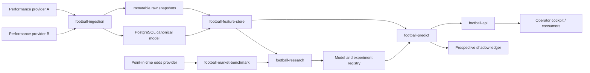

# Техническое задание: футбольная платформа вероятностных прогнозов

- Статус: проект ТЗ до начала реализации.
- Дата: 2026-07-12.
- Связанный проект: STRATUS.
- Рекомендуемая форма поставки: отдельный репозиторий или изолированный сервис.
- Денежные операции: запрещены в первой версии.

## 1. Решение и границы проекта

Создать самостоятельный football forecasting продукт, который до начала матча
формирует воспроизводимые и откалиброванные вероятности футбольных исходов.

Первая версия является аналитической системой, а не букмекером, посредником,
affiliate-витриной или автоматическим исполнителем ставок. Она не принимает деньги,
не хранит букмекерские учётные данные, не размещает ставки и не обещает прибыль.

Долгоживущая Git-ветка текущего репозитория не является целевой архитектурой. Ветка
допустима только для короткой интеграционной работы. Причины изоляции:

1. собственная предметная модель и Alembic lineage;
2. независимые источники данных, лицензии и секреты;
3. отдельный цикл обучения и релизов моделей;
4. отсутствие зависимости football deployment от weather/crypto migrations;
5. возможность отключить весь football-контур без влияния на STRATUS.

### 1.1. Рекомендуемый default scope

Если отдельное решение о лиге не принято, пилот запускается на немецкой Bundesliga.
Лига является конфигурацией, а не зашитым в код условием.

Первая версия прогнозирует только основное время матча:

- `1X2`: победа хозяев, ничья, победа гостей;
- `TOTAL_2_5`: меньше/больше 2.5 голов;
- `BTTS`: обе команды забьют — да/нет;
- полную матрицу счёта как внутренний базовый продукт модели.

Обязательные prediction cutoffs:

- `T24H`: за 24 часа до запланированного kickoff;
- `T60M`: за 60 минут до kickoff, после появления официальных составов, если они
  доступны вовремя.

Прогнозы разных cutoffs оцениваются, калибруются и версионируются раздельно.

### 1.2. Не входит в первую версию

- in-play прогнозирование;
- индивидуальные player props;
- экспрессы и bet-builder комбинации;
- автоматическое исполнение ставок;
- affiliate-ссылки и персонализированные букмекерские рекомендации;
- обещание фиксированной точности, ROI или win rate;
- scraping сайтов без явного договорного разрешения;
- нейросетевые модели как обязательная часть MVP;
- мобильное приложение;
- HFT, биржевая торговля и market making.

## 2. Основные инварианты

1. **Никакой информации из будущего.** Любая feature обязана иметь доказуемое
   `available_at <= prediction_cutoff`.
2. **Опубликованный прогноз неизменяем.** Исправление создаёт новую запись с причиной,
   исходная запись остаётся в аудите.
3. **Вероятности образуют полное распределение.** Для `1X2` сумма равна 1 с машинным
   допуском; остальные рынки выводятся из той же score distribution.
4. **Backfill не подменяет live.** Исторические данные с неизвестным временем
   публикации маркируются как `availability_proxy` и не смешиваются с observed live
   availability.
5. **Источник рынка не является истиной модели.** Odds хранятся как benchmark. Если
   odds входят в модель, результат явно маркируется `market_augmented`.
6. **Отрицательный результат сохраняется.** Experiment result не удаляется из-за того,
   что candidate проиграл champion.
7. **Лицензия — gate, а не примечание.** Источник без подтверждённого разрешённого
   использования не попадает в production pipeline.
8. **Нет live-money пути в MVP.** Даже ошибочная конфигурация не должна позволять
   разместить ставку.

## 3. Архитектурное решение

### 3.1. Размещение

Предпочтительный вариант:

```text
football-forecasting/
├── src/football_forecasting/
│   ├── api/
│   ├── collectors/
│   ├── domain/
│   ├── evaluation/
│   ├── features/
│   ├── jobs/
│   ├── models/
│   ├── repositories/
│   └── services/
├── migrations/
├── experiments/
├── tests/
│   ├── fixtures/
│   └── integration/
├── docs/
├── docker-compose.yml
└── pyproject.toml
```

Допустим монорепозиторий, если до реализации выделены `stratus_core` и отдельные
deployables. Добавление football-таблиц непосредственно в текущие weather-модели
запрещено.

### 3.2. Сервисы и ответственность



Логические компоненты могут работать в одном Python-процессе на MVP, но границы
модулей, таблиц и контрактов обязательны.

### 3.3. Технологический стек

Базовый стек согласован с текущим STRATUS:

- Python 3.12;
- FastAPI и Pydantic;
- PostgreSQL;
- SQLAlchemy asyncio и Alembic;
- APScheduler для MVP;
- httpx для provider adapters;
- pytest, mypy strict, Ruff;
- NumPy/SciPy для score models;
- scikit-learn для calibration, logistic baselines и metrics;
- CatBoost как optional tabular challenger после baseline gate;
- Parquet/object storage для крупных raw event datasets.

Airflow, Kafka, Spark, Kubernetes и feature-store platform не нужны до появления
доказанной нагрузки, которую не покрывает простой scheduler и PostgreSQL.

## 4. Временная семантика данных

Для каждого изменяемого факта хранятся четыре разных времени:

- `source_event_time`: когда факт относится к реальному миру;
- `available_at`: когда он стал доступен внешнему наблюдателю;
- `observed_at`: когда collector получил ответ;
- `ingested_at`: когда запись зафиксирована в системе.

Дополнительно:

- `valid_from` и `valid_to` для provider corrections;
- `source_version` и `raw_hash`;
- `availability_kind = observed | documented_proxy | unknown`.

Запись с `availability_kind=unknown` запрещено использовать в point-in-time training
и evaluation. Она может использоваться только для exploratory analysis.

## 5. Каноническая схема данных

Ниже перечислены обязательные таблицы. Префикс `football_` обязателен, если база
физически разделяется с другими доменами не сразу.

### 5.1. Справочники

#### `football_competitions`

- `id UUID PK`;
- `country_code`, `name`, `competition_type`;
- `timezone`;
- `active`;
- `created_at`, `updated_at`.

#### `football_seasons`

- `id UUID PK`;
- `competition_id FK`;
- `name`, `starts_on`, `ends_on`;
- `rules_version`;
- unique `(competition_id, name)`.

#### `football_teams`

- `id UUID PK`;
- `canonical_name`, `country_code`;
- `valid_from`, `valid_to`;
- `merged_into_team_id` для исправления identity;
- никакого автоматического fuzzy merge без manual review.

#### `football_team_aliases`

- `provider`, `provider_team_id`, `provider_name`;
- `team_id FK`;
- `valid_from`, `valid_to`;
- `mapping_status = verified | provisional | blocked`;
- `verified_by`, `verified_at`;
- unique `(provider, provider_team_id, valid_from)`.

Аналогичные таблицы нужны для players и competitions. Не следует считать имя
стабильным идентификатором.

### 5.2. Матчи и состояние

#### `football_fixtures`

- `id UUID PK`;
- `competition_id`, `season_id`;
- `home_team_id`, `away_team_id`;
- `scheduled_kickoff`, `venue_timezone`;
- `neutral_venue`;
- `status`;
- `result_home_90`, `result_away_90`;
- `result_source`, `result_version`;
- constraints: home и away различны, kickoff timezone-aware.

#### `football_fixture_source_links`

- `fixture_id`, `provider`, `provider_fixture_id`;
- `first_seen_at`, `last_seen_at`;
- unique `(provider, provider_fixture_id)`.

#### `football_fixture_status_events`

Append-only история изменения kickoff, переноса, отмены и результата:

- `fixture_id`, `status`, `scheduled_kickoff`;
- `source_event_time`, `available_at`, `observed_at`, `ingested_at`;
- `raw_hash`, `reason`.

Матч с перенесённым kickoff получает новые cutoffs. Старые predictions сохраняются и
маркируются `superseded_by_schedule_change`, но не удаляются.

### 5.3. Составы и доступность игроков

#### `football_lineup_snapshots`

- `fixture_id`, `team_id`, `player_id`;
- `lineup_kind = expected | official`;
- `role = starter | bench | unavailable`;
- `position_code`, `formation`;
- `available_at`, `observed_at`, `ingested_at`;
- `provider`, `provider_confidence`;
- unique по fixture/team/player/kind/observed snapshot.

#### `football_player_availability_events`

- `team_id`, `player_id`;
- `status = available | doubtful | injured | suspended | unknown`;
- `reason_code`;
- временные и source поля;
- новость без timestamp не используется как historical feature.

### 5.4. Результаты, статистика и xG

#### `football_team_match_stats`

- одна строка на fixture/team/provider/version;
- goals, shots, shots_on_target, cards, corners;
- `xg`, `xga` только с явным `xg_model_provider/version`;
- временные и provenance поля.

xG разных провайдеров нельзя склеивать в один ряд без отдельного calibration layer.
Post-match xG матча становится доступным только после его фактической публикации.

#### `football_shots`

Опциональная таблица event-level данных:

- fixture/team/player/event identity;
- minute, second, period;
- coordinates, body part, situation;
- goal flag, provider xG;
- source version и raw hash.

### 5.5. Рыночные коэффициенты

#### `football_odds_snapshots`

- `fixture_id`;
- `bookmaker`, `market`, `selection`;
- `decimal_odds`;
- `line_value` для totals/handicap;
- `source_updated_at`, `available_at`, `observed_at`, `ingested_at`;
- `is_opening`, `is_closing` определяются отдельным алгоритмом, не провайдерским
  mutable flag;
- unique `(provider, bookmaker, fixture_id, market, selection, observed_at)`.

#### `football_market_probability_snapshots`

Сохраняет результат de-vig, а не пересчитывает его молча после изменения алгоритма:

- ссылка на полный набор odds одного market snapshot;
- `method = multiplicative | shin | power`;
- `method_version`;
- `overround`;
- probabilities по всем selections;
- invariant sum probabilities = 1.

### 5.6. Модели и прогнозы

#### `football_model_versions`

- `model_id`, `name`, `family`, `version`;
- `training_data_hash`, `code_commit`, `config_hash`;
- `trained_through`, `created_at`;
- `status = candidate | champion | retired | blocked`;
- `market_augmented`;
- artifact URI и SHA-256.

#### `football_prediction_runs`

- `run_id`;
- `model_version_id`;
- `cutoff_kind`, `cutoff_time`;
- `feature_snapshot_hash`;
- `started_at`, `completed_at`, `status`;
- `failure_reason`;
- unique `(fixture_id, model_version_id, cutoff_kind, cutoff_time)` в связующей
  таблице результатов.

#### `football_predictions`

- `fixture_id`, `prediction_run_id`;
- `market`, `selection`, `probability`;
- `score_home`, `score_away` для score matrix;
- `explanation_payload` без скрытого chain-of-thought;
- `published_at`;
- `superseded_reason` nullable;
- check `0 <= probability <= 1`.

Для `1X2` и каждого бинарного рынка транзакционный constraint/service invariant
обязан проверять полную сумму вероятностей.

### 5.7. Эксперименты и оценка

#### `football_experiments`

- immutable experiment contract JSON;
- `experiment_hash` unique;
- data window, leagues, markets, cutoffs;
- candidate set;
- metrics and gate thresholds;
- `holdout_locked_at`, `holdout_unlocked_at`, actor и reason.

#### `football_experiment_results`

- `experiment_hash`, `candidate_hash`, fold, segment;
- metrics JSON;
- bootstrap seed и interval;
- data/code/config hashes;
- append-only;
- unique по полному identity результата.

#### `football_prospective_forecasts`

Неизменяемый shadow ledger прогнозов, фактически созданных до kickoff. Он является
источником истины для prospective gate.

## 6. Provider adapter contract

Каждый provider adapter реализует одинаковый интерфейс:

```python
class FootballProvider(Protocol):
    name: str

    async def fetch_competitions(self) -> ProviderBatch: ...
    async def fetch_fixtures(self, window: TimeWindow) -> ProviderBatch: ...
    async def fetch_fixture(self, provider_fixture_id: str) -> ProviderBatch: ...
    async def fetch_lineups(self, provider_fixture_id: str) -> ProviderBatch: ...
    async def fetch_team_stats(self, provider_fixture_id: str) -> ProviderBatch: ...
```

Odds provider реализует отдельный интерфейс, чтобы спортивная статистика и market
benchmark никогда не были неявно связаны одним provider response.

`ProviderBatch` содержит:

- raw bytes или canonical JSON;
- request URL без secret query parameters;
- response hash;
- provider timestamp;
- observed time;
- rate-limit metadata;
- schema version;
- parse warnings;
- completeness summary.

Парсер fail-closed: неизвестное enum-значение, пропавший обязательный timestamp или
конфликт identity блокирует соответствующий fixture, но не весь batch.

## 7. План 30-дневного provider bake-off

Сравнить минимум два performance providers на одной лиге. Odds source оценивается
отдельно.

### 7.1. Метрики scorecard

| Категория | Вес | Определение |
|---|---:|---|
| Лицензия и разрешённое использование | 20% | хранение, обучение, показ derived data, redistribution |
| Полнота fixtures/results | 15% | доля ожидаемых матчей без ручного восстановления |
| Временная целостность | 15% | наличие и достоверность publication/update timestamps |
| Lineup coverage | 15% | official XI до `T60M`, корректность starter/bench |
| Injury/suspension coverage | 10% | полнота, timestamp, corrections |
| Latency | 10% | p50/p95 между provider update и observed_at |
| Identity stability | 10% | remap, duplicate, renamed teams/players |
| Support/schema stability | 5% | changelog, versioning, воспроизводимость ответов |

Источник с неопределённой коммерческой лицензией получает `NO_GO` независимо от
суммарного балла.

### 7.2. Начальные acceptance thresholds

- fixtures и final results: не менее 99.5%;
- ноль silent fixture mismatches;
- official lineup coverage для `T60M`: не менее 95%;
- timestamp coverage для изменяемых фактов: не менее 99%;
- p95 ingestion latency в рамках заявленного prediction cutoff;
- все provider corrections сохраняются append-only;
- zero secret leakage в raw audit metadata.

## 8. Feature contract

Feature является разрешённой только при наличии:

- стабильного имени и версии;
- формулы;
- требуемых источников;
- point-in-time availability rule;
- missing-value policy;
- segment applicability;
- unit tests на временную границу;
- recorded lineage в prediction run.

### 8.1. Champion v1 features

- home advantage по competition/season с shrinkage;
- attack и defence strengths;
- exponential time decay, параметр выбран на validation;
- Elo difference;
- days since previous match;
- promoted-team prior с hierarchical shrinkage;
- neutral venue;
- подтверждённый lineup delta только в `T60M`.

### 8.2. Challenger features

- rolling xG/xGA по согласованному provider version;
- opponent-strength adjusted form;
- player plus-minus/ridge ratings;
- expected lineup uncertainty;
- coach change с фактическим announcement timestamp;
- travel distance и rest interaction;
- red-card adjusted historical performance.

Head-to-head не входит в champion v1. Он допускается как challenger и обязан доказать
incremental value после team strength, иначе удаляется.

## 9. Модельный контур

### 9.1. Baselines

Обязательны четыре контрольные модели:

1. league/home-away empirical prior;
2. Elo + multinomial logistic mapping;
3. independent Poisson;
4. Dixon-Coles с time weighting и low-score correction.

Модель, не превосходящая более простой baseline на будущем блоке, не продвигается.

### 9.2. Score distribution

Champion формирует `lambda_home` и `lambda_away`. Матрица счёта строится адаптивно:
верхняя граница голов увеличивается, пока отброшенная probability mass не станет
меньше `1e-8`. Затем матрица нормализуется и проверяется.

Из одной матрицы выводятся:

```text
P(H)    = sum P(x,y), x > y
P(D)    = sum P(x,y), x = y
P(A)    = sum P(x,y), x < y
P(O2.5) = sum P(x,y), x + y >= 3
P(BTTS) = sum P(x,y), x >= 1 and y >= 1
```

Независимое обучение отдельных classifiers для `1X2`, totals и BTTS в champion v1
запрещено: оно может создать взаимно противоречивые probabilities.

### 9.3. Идентифицируемость и regularization

- attack/defence parameters используют sum-to-zero constraints;
- promoted/relegated teams получают hierarchical prior, а не произвольный ноль;
- decay, regularization и calibration выбираются только на validation;
- никакой настройки по untouched holdout;
- model artifact хранит training window и список команд.

### 9.4. Calibration

Calibration выполняется отдельно по `cutoff_kind` и market. Calibrator обучается на
out-of-fold predictions, никогда на in-sample probabilities.

Порядок кандидатов:

1. без post-calibration;
2. sigmoid/temperature calibration;
3. isotonic только при достаточном calibration sample и с отдельным overfit gate.

Multiclass probabilities после classwise calibration снова нормализуются и проверяются.

## 10. Experiment contract

Каждый model experiment заранее регистрирует:

```json
{
  "schema_version": 1,
  "competition_codes": ["BL1"],
  "markets": ["1X2", "TOTAL_2_5", "BTTS"],
  "cutoffs": ["T24H", "T60M"],
  "development_window": ["2018-07-01", "2023-06-30"],
  "validation_window": ["2023-07-01", "2024-06-30"],
  "holdout_window": ["2024-07-01", "2026-06-30"],
  "feature_set_version": "v1",
  "candidates": ["elo_v1", "poisson_v1", "dixon_coles_v1"],
  "primary_metric": "multiclass_log_loss",
  "secondary_metrics": ["multiclass_brier", "rps", "calibration_error"],
  "bootstrap_unit": "competition_matchweek",
  "bootstrap_samples": 10000,
  "seed": 20260712
}
```

Даты в примере являются шаблоном и уточняются после аудита реальной истории.
Experiment hash меняется при любом изменении features, windows, candidates, costs,
de-vig метода или thresholds.

Исторический holdout означает только отсутствие доступа к labels после регистрации
experiment contract. Поскольку результаты уже существуют во внешнем мире, он не
заменяет prospective shadow и не даёт права заявлять доказанный production edge.

### 10.1. Временная проверка

Используется rolling-origin evaluation:

1. fit только на матчах, доступных до fold cutoff;
2. features следующего блока materialize as-of cutoff;
3. predictions фиксируются до открытия labels;
4. fold расширяет training window вперёд;
5. все матчи одного matchweek/date остаются в одном block.

Random split и обычный shuffled cross-validation запрещены.

### 10.2. Метрики

Primary:

- multiclass log loss для `1X2`.

Secondary:

- multiclass Brier;
- Ranked Probability Score;
- binary log loss/Brier для totals и BTTS;
- calibration intercept и slope;
- reliability diagram с sample counts;
- classwise calibration;
- coverage и failure rate.

Accuracy и F1 являются informational metrics и не определяют promotion.

### 10.3. Статистическое сравнение

- сравнивается paired loss на тех же fixtures;
- confidence interval строится block bootstrap по competition/matchweek;
- отчёт содержит mean delta, 95% CI, worst season, worst league и sensitivity;
- фиксированный sample threshold является временной политикой;
- после пилота обязательна power analysis по наблюдаемой paired variance.

## 11. Рыночный benchmark

Для каждого prediction cutoff формируются отдельные market probabilities:

- consensus на том же cutoff;
- выбранный sharp benchmark, если лицензирован;
- closing consensus как post-hoc benchmark;
- best executable odds для economic simulation.

Сырые inverse odds не являются probabilities из-за overround. Experiment contract
фиксирует de-vig method. Минимум сравниваются `multiplicative`, `shin` и `power`, а
один метод выбирается до untouched holdout.

Model-vs-market comparison корректно только при одинаковых fixtures, рынках,
settlement rules и cutoff.

## 12. Validation gates

### G0 — Data and licence

Проходит, если:

- provider bake-off завершён;
- права на хранение, обучение и показ derived probabilities подтверждены;
- fixture/result coverage выше threshold;
- нет unresolved identity conflicts.

### G1 — Point-in-time correctness

Проходит, если:

- не менее 50 golden fixtures проверены вручную;
- все features воспроизводятся as-of cutoff;
- zero future-data violations;
- backfill/live parity объяснена и измерена;
- forecast snapshots immutable.

### G2 — Baseline quality

Проходит, если Dixon-Coles/selected champion:

- превосходит empirical prior по primary metric;
- не регрессирует критически относительно Elo/Poisson;
- имеет acceptable calibration;
- сохраняет результат в большинстве season blocks.

Начальный ориентир — минимум 2,000 OOS fixtures, но promotion определяется paired CI
и power analysis, а не одним числом.

### G3 — Candidate promotion

Candidate становится champion, только если:

- primary metric delta лучше нуля с 95% paired block-bootstrap CI;
- calibration не регрессирует;
- improvement не держится на одной лиге/сезоне;
- latency и coverage остаются production-compatible;
- complexity justified: более сложная модель должна давать измеримый выигрыш.

### G4 — Market-relative evidence

Для аналитического продукта достаточно точной calibration и понятного сравнительного
позиционирования. Для заявления о market edge требуется:

- сравнение с de-vig market на одинаковом cutoff;
- lower CI преимущества по заранее выбранной метрике;
- отсутствие зависимости от stale/weak bookmaker;
- отдельный отчёт для `market_augmented` и независимой модели.

### G5 — Prospective shadow

Проходит после заранее рассчитанного sample/time target, первоначально не менее одного
полного сезонного цикла для основной лиги:

- прогнозы созданы реально до kickoff;
- source latency и corrections наблюдаются, а не реконструируются;
- live coverage соответствует backtest assumptions;
- model drift находится в заданных пределах.

### G6 — Economic paper, опционально

Этот gate нужен только если дальнейшая цель включает ставки:

- executable odds, limits, rejects и voids моделируются;
- положительные CLV и net expectancy имеют нижнюю 95% границу выше нуля;
- стресс худшей цены/комиссии не делает результат отрицательным;
- PnL без top-N outcomes остаётся положительным;
- нет концентрации по одной лиге, команде или bookmaker;
- ориентир — 1,000 qualifying opportunities, уточнённый power analysis.

Прохождение G6 не разрешает live автоматически. Юридический и операционный gate
создаётся отдельным документом после выбора страны и оператора.

## 13. Public API contract

Все публичные endpoints read-only.

### 13.1. Fixtures

```text
GET /api/v1/football/fixtures
    ?competition=BL1
    &date_from=2026-08-01
    &date_to=2026-08-03
```

Возвращает canonical fixture identity, kickoff, статус и availability прогнозов.

### 13.2. Прогноз матча

```text
GET /api/v1/football/fixtures/{fixture_id}/predictions?cutoff=T24H
```

Пример ответа:

```json
{
  "fixture_id": "uuid",
  "competition": "BL1",
  "scheduled_kickoff": "2026-08-01T18:30:00+02:00",
  "cutoff": {
    "kind": "T24H",
    "time": "2026-07-31T18:30:00+02:00"
  },
  "model": {
    "name": "dixon_coles",
    "version": "1.0.0",
    "market_augmented": false
  },
  "probabilities": {
    "home": 0.472,
    "draw": 0.274,
    "away": 0.254,
    "over_2_5": 0.531,
    "btts_yes": 0.557
  },
  "expected_goals": {
    "home": 1.61,
    "away": 1.14
  },
  "lineup_state": "not_official",
  "published_at": "2026-07-31T18:30:12+02:00",
  "quality": {
    "status": "eligible",
    "warnings": []
  }
}
```

Probabilities в примере иллюстративны и не являются реальным прогнозом.

### 13.3. Model and validation endpoints

```text
GET /api/v1/football/models
GET /api/v1/football/validation-overview
GET /api/v1/football/calibration?model=...&cutoff=...
GET /api/v1/football/data-health
GET /api/v1/football/provider-bakeoff
```

### 13.4. API invariants

- endpoint не возвращает prediction при incomplete probability mass;
- blocked fixture возвращает конкретный reason code;
- unpublished candidate predictions недоступны публично;
- исправленный forecast не затирает старую версию;
- никакого endpoint для placement, wallet или bookmaker credentials;
- explanation описывает факторы и uncertainty, но не раскрывает скрытые рассуждения.

## 14. Jobs и расписание MVP

Точная частота зависит от quota provider, но контракт следующий:

- fixture discovery: каждые 30 минут;
- fixture status reconciliation: каждые 10 минут для ближайших 48 часов;
- odds snapshots: каждые 5–10 минут для ближайших матчей;
- expected lineup/injury refresh: каждые 30 минут, чаще в последние 3 часа;
- official lineup refresh: каждые 5 минут в интервале `T90M..kickoff`;
- `T24H` prediction materialization: каждую минуту по due queue;
- `T60M` materialization: после official lineup либо в cutoff с warning;
- result settlement: каждые 10 минут;
- daily data-quality audit;
- weekly research evaluation без автоматической promotion;
- model promotion только explicit operator action с audit reason.

Job identity и idempotency key включают provider, fixture, job kind и logical window.

## 15. Data-quality и observability

Обязательные health checks:

- provider freshness;
- fixture coverage;
- duplicate/missing source identity;
- kickoff drift;
- lineup completeness;
- probability sums;
- prediction due/missing;
- odds snapshot age и overround sanity;
- result reconciliation;
- model artifact hash;
- feature availability drift;
- calibration drift;
- job uptime и consecutive failures.

Каждая проблема имеет severity, first/last seen, affected fixtures, suggested action и
deduplication key. Critical issue блокирует новые publications соответствующего scope,
но не удаляет уже опубликованные forecasts.

## 16. Безопасность и юридические gates

- secrets только в environment/secret store;
- raw request metadata не содержит API keys;
- отдельные credentials на dev/staging/prod;
- публичный API read-only и rate-limited;
- лицензии и data retention документируются по provider;
- team/player logos не показываются без подтверждённых прав;
- no affiliate links в MVP;
- no underage-targeted UX;
- no personalized betting profile;
- legal review обязателен до любого betting-related продукта.

## 17. Тестовая стратегия

### 17.1. Unit tests

- identity mapping и conflict handling;
- cutoff/as-of filters;
- Dixon-Coles likelihood и constraints;
- score-matrix mass;
- derived-market probabilities;
- de-vig algorithms;
- calibration normalization;
- experiment hashing;
- schedule-change semantics;
- provider enum/schema failures.

### 17.2. Golden fixtures

Минимум 50 матчей с вручную зафиксированными:

- provider payload hashes;
- kickoff history;
- expected/official lineup availability;
- feature values на обоих cutoffs;
- odds snapshots;
- model inputs/outputs;
- final 90-minute result.

Golden fixtures включают перенос, отмену, neutral venue, promoted team, missing lineup,
red card history и provider correction.

### 17.3. Integration tests

- PostgreSQL round trips;
- Alembic upgrade from empty DB;
- collector idempotency;
- crash/retry between raw storage and canonical write;
- concurrent prediction claims;
- immutable publication;
- result reconciliation;
- API blocked/eligible responses.

## 18. Backlog реализации

### F0 — Решение и репозиторий

- согласовать product scope и primary league;
- завершить checkpoint текущего STRATUS;
- создать отдельный repository/worktree;
- зафиксировать ADR об изоляции football domain.

### F1 — Foundation

- pyproject, lint/type/test gates;
- Docker PostgreSQL;
- config и secret contract;
- FastAPI health endpoints;
- initial Alembic migration;
- provider interfaces и fake adapters.

### F2 — Provider bake-off

- два real adapters;
- immutable raw capture;
- canonical identity registry;
- 30-дневный scorecard;
- licence decision record.

### F3 — Point-in-time data plane

- fixtures/status history;
- lineups/availability;
- stats/xG;
- odds snapshots и de-vig;
- data-quality audit.

### F4 — Baseline research

- empirical prior;
- Elo;
- independent Poisson;
- Dixon-Coles;
- score-derived markets;
- rolling-origin evaluator.

### F5 — Validation and registry

- experiment contracts/hashes;
- locked holdout workflow;
- bootstrap intervals;
- calibration reports;
- candidate/champion registry;
- model-vs-market report.

### F6 — Prediction service

- due-cutoff scheduler;
- immutable prediction ledger;
- public read-only API;
- explanations and quality warnings;
- operator validation overview.

### F7 — Prospective shadow

- production-like collectors;
- T24H/T60M forecasts;
- correction and latency monitoring;
- full seasonal validation report.

### F8 — Betting research, deferred

Начинается только по отдельному решению после G5. Требует собственного ТЗ, правовой
оценки, bookmaker contract, execution simulator и risk model.

## 19. Первый implementation sprint

Sprint начинается только после безопасной фиксации текущего STRATUS. Его Definition of
Done:

1. создан отдельный `football-forecasting` workspace;
2. Python 3.12 project проходит Ruff, mypy strict и pytest;
3. PostgreSQL поднимается через Docker;
4. initial migration создаёт competitions, seasons, teams, aliases, fixtures,
   source links и raw ingestion manifests;
5. fake provider adapter загружает не менее 10 deterministic fixtures;
6. повторный import не создаёт duplicates;
7. ambiguous team mapping блокируется и попадает в audit issue;
8. `GET /healthz`, `GET /readyz` и fixtures endpoint покрыты тестами;
9. документация содержит локальный runbook;
10. никакого model training и внешней покупки API в этом sprint.

## 20. Открытые решения перед F0

Следующие решения фиксируются в ADR, но не блокируют подготовку foundation:

1. primary league: Bundesliga либо другая выбранная лига;
2. продуктовая география и юридическая страна;
3. analytical-only или будущий betting research;
4. допустимый месячный бюджет данных;
5. необходимость forecast до official lineup;
6. публичный consumer UI либо только internal/B2B API;
7. отдельный repository либо формализованный monorepo.

До ответа используются default assumptions этого ТЗ: Bundesliga, analytical-only,
`T24H` и `T60M`, отдельный repository, без денежных операций.

## 21. Definition of Done первой фазы

Первая фаза считается завершённой, когда:

- provider и licence gate пройдены;
- point-in-time pipeline воспроизводит 50 golden fixtures без leakage;
- четыре baselines оценены rolling-origin способом;
- predictions и market benchmark сравниваются на одном cutoff;
- API публикует immutable calibrated probabilities;
- prospective shadow запущен;
- отсутствует технический путь к размещению реальных ставок;
- отрицательные результаты и блокировки видны оператору;
- все решения воспроизводимы по data/code/config hashes.

## 22. Исследовательская и нормативная основа

Методология и требования этого ТЗ опираются на следующие первичные или официальные
источники, проверенные при подготовке исследования 2026-07-12:

- Maher, *Modelling association football scores*:
  <https://doi.org/10.1111/j.1467-9574.1982.tb00782.x>;
- Dixon and Coles, *Modelling Association Football Scores and Inefficiencies in
  the Football Betting Market*:
  <https://doi.org/10.1111/1467-9876.00065>;
- Gneiting and Raftery, *Strictly Proper Scoring Rules, Prediction, and
  Estimation*: <https://doi.org/10.1198/016214506000001437>;
- Hvattum and Arntzen, football prediction with team and player ratings:
  <https://doi.org/10.1177/1471082X20929881>;
- scikit-learn probability calibration guidance:
  <https://scikit-learn.org/stable/modules/calibration.html>;
- StatsBomb Open Data and its terms:
  <https://github.com/statsbomb/open-data>;
- football-data.org API documentation:
  <https://docs.football-data.org/general/v4/competition.html>;
- API-Football pricing and coverage:
  <https://www.api-football.com/pricing>;
- Sportmonks plans and football API documentation:
  <https://www.sportmonks.com/football-api/plans-pricing/>;
- The Odds API historical snapshot documentation:
  <https://the-odds-api.com/liveapi/guides/v4/>;
- German GGL information on legal sports-betting providers:
  <https://www.gluecksspiel-behoerde.de/de/fuer-spielende/informationen-fuer-spielende-faqs/sportwetten-und-wettanbieter>;
- European Commission information on GDPR and automated decision-making:
  <https://commission.europa.eu/law/law-topic/data-protection/information-individuals_en>.
